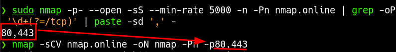

_____

```bash
IP=10.10.10.10
```
# NMAP

```bash
sudo nmap -p- --open -sS --min-rate 5000 -n -Pn $IP | grep -oP '\d+(?=/tcp)' | paste -sd ',' -
```

- `-p-`: Scan all ports (1-65535) for the target.
- `--open`: Show only open (or possibly open) ports.
- `-sS`: Use SYN scan, also known as stealth scan. It sends SYN packets to the target and waits for responses.
- `--min-rate 5000`: Send packets at a rate of 5000 per second.
- `-n`: Disable DNS resolution (show numerical IP addresses only).
- `-Pn`: Treat all hosts as online (skip host discovery).
- `$IP`: This is a variable representing the target IP address. It should be replaced with the actual IP address before running the command.
- `grep -oP '\d+(?=/tcp)'`: Extracts the port numbers from the Nmap output using a Perl-compatible regular expression (PCRE). It looks for sequences of digits followed by "/tcp".
- `paste -sd ',' -`: Joins the extracted port numbers into a comma-separated list.

This command is used to perform a comprehensive port scan on a target system, discovering all *open ports* and presenting the results as a comma-separated list of port numbers.


```bash
nmap -sCV $IP -oN nmap -Pn -p80,443
```
### Explanation of Command

- `-sCV`: Perform a version detection scan with default scripts against the target.
- `$IP`: This is a variable representing the target IP address. It should be replaced with the actual IP address before running the command.
- `-oN nmap`: Output scan results to a file named "nmap" in normal format.
- `-Pn`: Treat all hosts as online (skip host discovery).
- `-p`: Specify ports to scan. In this case, it will use the output of the previous command as the list of ports to scan.

This command builds upon the previous `sudo nmap` command by conducting a version detection scan (`-sCV`) using default scripts against the same target IP address. The results are saved to a file named "nmap" in the current directory.




## UDP

```bash
sudo nmap -sU --top-ports 10 -sV $IP
```
# Versions

- OpenSSH(Ubuntu): https://packages.ubuntu.com/search?keywords=openssh-server
- Apache(Debian): https://packages.debian.org/search?keywords=apache2

Based on the [OpenSSH](https://packages.ubuntu.com/search?keywords=openssh-server) version, the host is like running Ubuntu 20.04. But the [Apache](https://packages.debian.org/search?keywords=apache2) version shows Debian, likely Debian 10 Buster. This is a good indication there’s likely some kind of *container* here.
