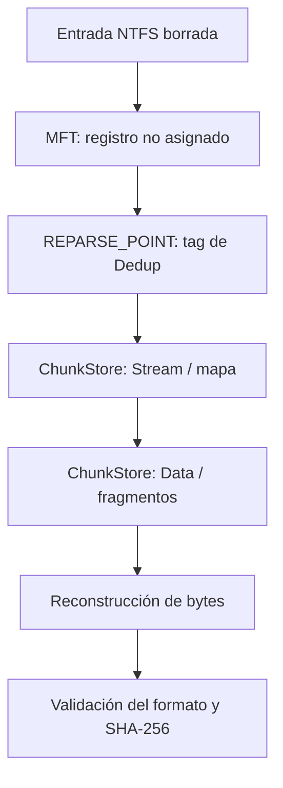

# Windows Data Deduplication — Guía forense

Windows Server puede ahorrar espacio **desduplicando fragmentos iguales** de varios archivos. Los archivos optimizados conservan su apariencia normal para el usuario, pero sus datos pueden referenciar bloques reutilizados en un `ChunkStore`.

## 1. Cómo funciona


```text
Archivo A = chunk 1 + chunk 2 + chunk 3
Archivo B = chunk 1 + chunk 2 + chunk 4

ChunkStore = [1] [2] [3] [4]  (almacena 1 y 2 una sola vez)
Referencia A -> 1,2,3
Referencia B -> 1,2,4
```

Las operaciones de **instalar la característica**, **habilitarla en un volumen**, **optimizar** y **garbage collection** son distintas. Un evento de instalación no demuestra que los archivos ya estuvieran optimizados.

## 2. Evidencias relevantes

| Artefacto | Utilidad |
|---|---|
| `System.evtx` / `Setup.evtx` | Instalación de servicios y paquetes |
| `Microsoft-Windows-Deduplication/Operational` | Inicio/fin de jobs, errores y estadísticas por ejecución |
| `System Volume Information\Dedup\Settings\` | Configuración de deduplicación |
| `State\dedupStatistics.xml` | Estado agregado: conteos, ahorro, tamaños |
| `ChunkStore\...\Stream\*.ccc` | Identificadores y mapas de chunks |
| `ChunkStore\...\Data\*.ccc` | Payloads físicos y cabeceras de chunks |
| `$MFT` + `$REPARSE_POINT` | Asociación del archivo con el flujo deduplicado |

La disposición interna varía según versión y formato. **No asumir offsets estáticos** en todas las evidencias.

## 3. Identificar el tipo de reparse point

Un registro con `FILE_ATTRIBUTE_REPARSE_POINT` (`0x0400`) contiene o referencia datos que un filtro del sistema interpreta. El **tag de Windows Deduplication** es `0x80000013`. El indicador por sí solo no distingue Dedup de enlaces, redirecciones u otros reparse points.

En NTFS, `$REPARSE_POINT` usa el tipo de atributo **`0xC0`**. No confundir:

- **MFT Record Flags**: `0x0000`, `0x0001`, `0x0002` (estado y directorio).
- **FILE_ATTRIBUTE**: `0x0020` ARCHIVE, `0x0200` SPARSE_FILE, `0x0400` REPARSE_POINT.
- **Reparse tag**: identificador del mecanismo, p. ej. `0x80000013` para Dedup.

## 4. ¿Por qué interesa en la recuperación?

Al borrar un archivo optimizado, la entrada del directorio desaparece y su MFT puede quedar marcada como libre. Sin embargo, la referencia al flujo y sus chunks físicos pueden permanecer hasta la reutilización o limpieza. Así **podría** reconstruirse su contenido si se preservan todos los metadatos y chunks necesarios.



**Advertencia:** una exportación lógica puede devolver bytes nulos si el archivo deduplicado no se rehidrata. Nunca calcular el hash de un archivo lleno de ceros y presentarlo como recuperación correcta.

## 5. Validación mínima

```bash
file archivo_recuperado.docx
unzip -t archivo_recuperado.docx
sha256sum archivo_recuperado.docx
```

DOCX es un ZIP con piezas XML como `word/document.xml` y `docProps/core.xml`. El campo `dc:creator` representa un autor **registrado en metadatos**, no identifica necesariamente a quien eliminó el documento ni demuestra responsabilidad.

## 6. Preguntas que no se deben mezclar

- **SavedSpace de un job** ≠ **savingsSize acumulado** de estadísticas.
- **Timestamp de changeTime** ≠ prueba concluyente del tipo de cambio realizado.
- **Fecha de la tarea** ≠ constancia de que realmente se ejecutó.
- **Estado borrado en MFT** ≠ garantía de que todos los chunks sigan disponibles.

## Lecturas

- [Microsoft — Data Deduplication overview](https://learn.microsoft.com/en-us/windows-server/storage/data-deduplication/overview)
- [Microsoft — Understanding Deduplication](https://learn.microsoft.com/en-us/windows-server/storage/data-deduplication/understand)
- [NTFS: $MFT y archivos eliminados](ntfs-deleted-files.md)

[DFIR](./README.md)
