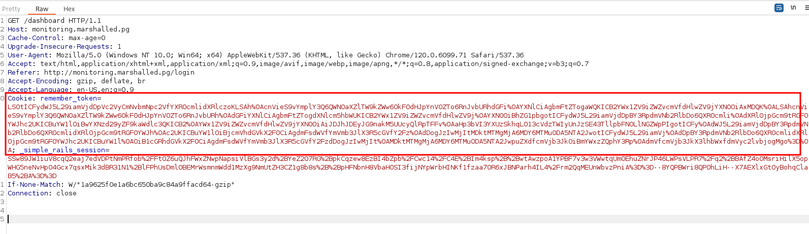

_____

> [!info]
> IP=192.168.209.237

# Nmap 

|PORT|STATE|SERVICE|
|---|---|---|
|22/tcp|open|ssh|
|80/tcp|open|http|

```python
PORT   STATE SERVICE VERSION
22/tcp open  ssh     OpenSSH 8.2p1 Ubuntu 4ubuntu0.5 (Ubuntu Linux; protocol 2.0)
| ssh-hostkey: 
|   3072 62:36:1a:5c:d3:e3:7b:e1:70:f8:a3:b3:1c:4c:24:38 (RSA)
|   256 ee:25:fc:23:66:05:c0:c1:ec:47:c6:bb:00:c7:4f:53 (ECDSA)
|_  256 83:5c:51:ac:32:e5:3a:21:7c:f6:c2:cd:93:68:58:d8 (ED25519)
80/tcp open  http    Apache httpd 2.4.41 ((Ubuntu))
|_http-server-header: Apache/2.4.41 (Ubuntu)
|_http-title: Site doesnt have a title (text/html).
```

## 80 - http

marshalled.pg

### Vhost
```bash
gobuster vhost -v -u http://marshalled.pg -w /usr/share/seclists/Discovery/DNS/subdomains-top1million-5000.txt -t 20 | grep -v "400"|grep -v "Missed"
```

monitoring.marshalled.pg
	admin:admin



base64 decode

```rb
--- !ruby/object:User
concise_attributes:
- !ruby/object:ActiveModel::Attribute::FromDatabase
  name: id
  value_before_type_cast: 104
- !ruby/object:ActiveModel::Attribute::FromDatabase
  name: username
  value_before_type_cast: admin
- !ruby/object:ActiveModel::Attribute::FromDatabase
  name: password_digest
  value_before_type_cast: "$2a$12$ogjC9QG2BTiLQohzwmR7au3JHj/MwqWsMb2RrsHN7NYilSN.SFejO"
- !ruby/object:ActiveModel::Attribute::FromDatabase
  name: created_at
  value_before_type_cast: '2022-09-13 20:06:13.809506'
- !ruby/object:ActiveModel::Attribute::FromDatabase
  name: updated_at
  value_before_type_cast: '2022-09-13 20:06:13.809506'
new_record: false
active_record_yaml_version: 2
```
