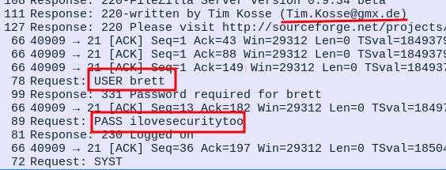

_____

IP=192.168.179.39


# 80 - http

CS-Cart. Powerful PHP shopping cart software
Version 1.3.3
admin:admin

1. Visit "cs-cart" /admin.php and login (Remember: You need to login on **ADMIN** section not on the regular **USER** section).
2. Under **Look and Feel** section click on "**template editor**".
3. And under that section, upload your malicious **.php** file, make sure you rename it to **.phtml** before you upload.
4. If successful, you should be able to get a **RCE**.
5. For example, grab this file -> [https://raw.githubusercontent.com/F-Masood/php-backdoors/main/whoami.php](https://raw.githubusercontent.com/F-Masood/php-backdoors/main/whoami.php) and rename it to whoami.phtml
6. Now, visit http://[victim]/skins/whoami.phtml
7. And you should see '**www-data**' or '**apache**' etc as the output.


# PrivEsc

```bash
mysql -u root -p
root
```


/root/capture.cap

Tim.Kosse@gmx.de

USER brett
PASS ilovesecuritytoo



```bash
su patrick
patrick
```

```txt
User patrick may run the following commands on this host:
    (ALL) ALL
```
