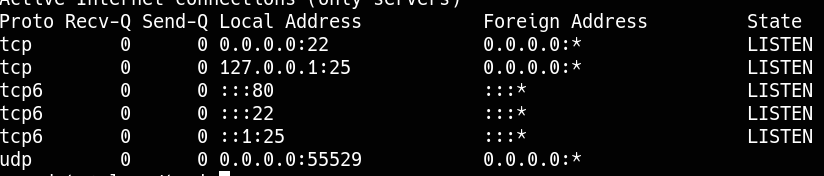

____

> [!info]
> IP=192.168.179.28

# Nmap 

|PORT|STATE|SERVICE|
|---|---|---|
|22/tcp|open|ssh|
|80/tcp|open|http|

```python
PORT   STATE SERVICE VERSION
22/tcp open  ssh     OpenSSH 8.4p1 Debian 5+deb11u1 (protocol 2.0)
| ssh-hostkey: 
|   3072 c9:c3:da:15:28:3b:f1:f8:9a:36:df:4d:36:6b:a7:44 (RSA)
|   256 26:03:2b:f6:da:90:1d:1b:ec:8d:8f:8d:1e:7e:3d:6b (ECDSA)
|_  256 fb:43:b2:b0:19:2f:d3:f6:bc:aa:60:67:ab:c1:af:37 (ED25519)
80/tcp open  http    Apache httpd 2.4.56 ((Debian))
|_http-server-header: Apache/2.4.56 (Debian)
|_http-title: PluXml - Blog or CMS, XML powered !
```


## 80 - http

- PluXml - Blog or CMS, XML powered

### /core/admin
admin:admin

- 5.8.7 version

https://github.com/MoritzHuppert/CVE-2022-25018/blob/main/CVE-2022-25018.pdf

- Static pages --> edit one of the pages
- Insert PHP (reverse shell monkey pentester)

# PrivEsc



/var/mail/www-data

root:6s8kaZZNaZZYBMfh2YEW
