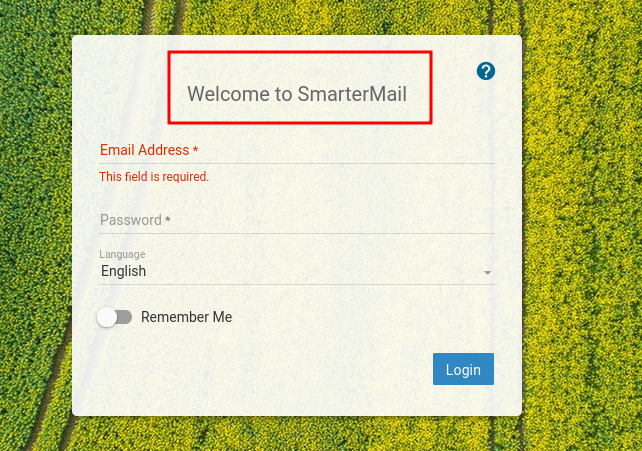

_____

>[!INFO]
> IP=192.168.227.65
> Windows

# Nmap
| PORT      | STATE | SERVICE       |
|-----------|-------|---------------|
| 21/tcp    | open  | ftp           |
| 80/tcp    | open  | http          |
| 135/tcp   | open  | msrpc         |
| 139/tcp   | open  | netbios-ssn   |
| 445/tcp   | open  | microsoft-ds  |
| 5040/tcp  | open  | unknown       |
| 7680/tcp  | open  | pando-pub     |
| 9998/tcp  | open  | distinct32    |
| 17001/tcp | open  | unknown       |
| 49664/tcp | open  | unknown       |
| 49665/tcp | open  | unknown       |
| 49666/tcp | open  | unknown       |
| 49667/tcp | open  | unknown       |
| 49668/tcp | open  | unknown       |
| 49669/tcp | open  | unknown       |


```python
PORT      STATE  SERVICE       VERSION
21/tcp    open   ftp           Microsoft ftpd
| ftp-anon: Anonymous FTP login allowed (FTP code 230)
| 04-29-20  09:31PM       <DIR>          ImapRetrieval
| 02-06-24  12:39PM       <DIR>          Logs
| 04-29-20  09:31PM       <DIR>          PopRetrieval
|_04-29-20  09:32PM       <DIR>          Spool
| ftp-syst:
|_  SYST: Windows_NT
80/tcp    open   http          Microsoft IIS httpd 10.0
|_http-server-header: Microsoft-IIS/10.0
|_http-title: IIS Windows
| http-methods:
|_  Potentially risky methods: TRACE
135/tcp   open   msrpc         Microsoft Windows RPC
139/tcp   open   netbios-ssn   Microsoft Windows netbios-ssn
445/tcp   open   microsoft-ds?
5040/tcp  open   unknown
7680/tcp  closed pando-pub
9998/tcp  open   http          Microsoft IIS httpd 10.0
| uptime-agent-info: HTTP/1.1 400 Bad Request\x0D
| Content-Type: text/html; charset=us-ascii\x0D
| Server: Microsoft-HTTPAPI/2.0\x0D
| Date: Tue, 06 Feb 2024 20:44:52 GMT\x0D
| Connection: close\x0D
| Content-Length: 326\x0D
...

17001/tcp open   remoting      MS .NET Remoting services
49664/tcp open   msrpc         Microsoft Windows RPC
49665/tcp open   msrpc         Microsoft Windows RPC
49666/tcp open   msrpc         Microsoft Windows RPC
49667/tcp open   msrpc         Microsoft Windows RPC
49668/tcp open   msrpc         Microsoft Windows RPC
49669/tcp open   msrpc         Microsoft Windows RPC
Service Info: OS: Windows; CPE: cpe:/o:microsoft:windows

Host script results:
| smb2-time:
|   date: 2024-02-06T20:44:56
|_  start_date: N/A
|_clock-skew: -5h59m50s
| smb2-security-mode:
|   3:1:1:
|_    Message signing enabled but not required
```


# 9998 - http


SmarterMail Build 6985 - Remote Code Execution
https://github.com/devzspy/CVE-2019-7214

```txt
# SmarterMail before build 6985 provides a .NET remoting endpoint
# which is vulnerable to a .NET deserialisation attack.
```
