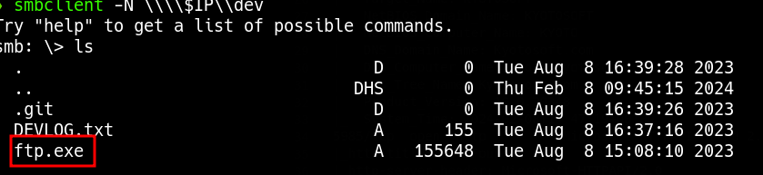

_____

>[!INFO]
> IP=192.168.222.31
> Windows

# Nmap

```bash
sudo nmap -p- --open -sS --min-rate 5000 -n -Pn $IP | grep -oP '\d+(?=/tcp)' | paste -sd ',' -
```

```python
PORT STATE SERVICE VERSION
53/tcp open domain Simple DNS Plus
88/tcp open kerberos-sec Microsoft Windows Kerberos (server time: 2024-02-08 14:46:21Z)
111/tcp open rpcbind?
|_rpcinfo: ERROR: Script execution failed (use -d to debug)
135/tcp open msrpc Microsoft Windows RPC
139/tcp open netbios-ssn Microsoft Windows netbios-ssn
389/tcp open ldap Microsoft Windows Active Directory LDAP (Domain: Kyotosoft.com0., Site: Default-First-Site-Name)
445/tcp open microsoft-ds?
464/tcp open kpasswd5?
593/tcp open ncacn_http Microsoft Windows RPC over HTTP 1.0
636/tcp open tcpwrapped
2049/tcp open mountd 1-3 (RPC #100005)
3268/tcp open ldap Microsoft Windows Active Directory LDAP (Domain: Kyotosoft.com0., Site: Default-First-Site-Name)
3269/tcp open tcpwrapped
3389/tcp open ms-wbt-server Microsoft Terminal Services
| ssl-cert: Subject: commonName=kyoto.Kyotosoft.com
| Not valid before: 2024-02-07T14:45:04
|_Not valid after: 2024-08-08T14:45:04
|_ssl-date: 2024-02-08T14:47:59+00:00; -5h59m50s from scanner time.
| rdp-ntlm-info:
| Target_Name: KYOTOSOFT
| NetBIOS_Domain_Name: KYOTOSOFT
| NetBIOS_Computer_Name: KYOTO
| DNS_Domain_Name: Kyotosoft.com
| DNS_Computer_Name: kyoto.Kyotosoft.com
| DNS_Tree_Name: Kyotosoft.com
| Product_Version: 10.0.20348
|_ System_Time: 2024-02-08T14:47:19+00:00
5985/tcp open http Microsoft HTTPAPI httpd 2.0 (SSDP/UPnP)
|_http-title: Not Found
|_http-server-header: Microsoft-HTTPAPI/2.0
9389/tcp open mc-nmf .NET Message Framing
49664/tcp open msrpc Microsoft Windows RPC
49665/tcp open msrpc Microsoft Windows RPC
49666/tcp open msrpc Microsoft Windows RPC
49667/tcp open msrpc Microsoft Windows RPC
49668/tcp open msrpc Microsoft Windows RPC
49672/tcp open msrpc Microsoft Windows RPC
52256/tcp open ncacn_http Microsoft Windows RPC over HTTP 1.0
52257/tcp open msrpc Microsoft Windows RPC
52272/tcp open msrpc Microsoft Windows RPC
52279/tcp open msrpc Microsoft Windows RPC
52284/tcp open msrpc Microsoft Windows RPC
Service Info: Host: KYOTO; OS: Windows; CPE: cpe:/o:microsoft:windows
Host script results:
| smb2-security-mode:
| 3:1:1:
|_ Message signing enabled and required
| smb2-time:
| date: 2024-02-08T14:47:20
|_ start_date: N/A
|_clock-skew: mean: -5h59m50s, deviation: 0s, median: -5h59m50s
```

https://rana-khalil.gitbook.io/hack-the-box-oscp-preparation/windows-boxes/active-writeup-w-o-metasploit

## 445 - smb

```bash
smbclient -L \\$IP
smbclient -N \\\\$IP\\dev
```



```bash
strings ftp.exe
admin:SafariDozeDust17
```

```bash
crackmapexec smb $IP -u "admin" -p "SafariDozeDust17"
```

Buffer over flow
