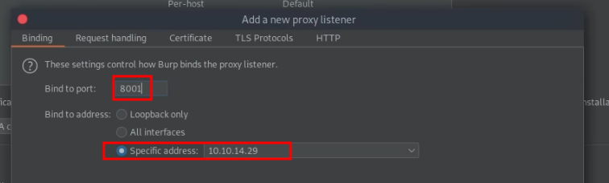

_____
```bash
sudo apt install adb snapd
systemctl start snapd.service
```

adb: android debug bridge
# Anbox

https://github.com/anbox/anbox

```bash
git clone https://github.com/anbox/anbox.git --recurse-submodules
cd anbox
mkdir build
cd build
cmake ..
make
```

```bash
snap install --devmode --beta anbox 
```


## install apk

```bash
adb install file.apk
```


## burpsuite

```bash
adb shell settings put global http_proxy 10.10.14.29:8001
```


