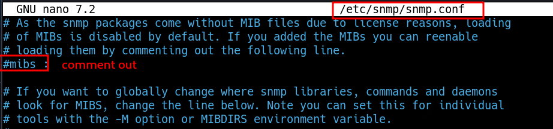

______
UDP

```bash
snmpwalk -v 2c -c public $IP
```

```
snmpbulkwalk -c public -v2c $IP . 
```

# Readable output

`sudo apt install snmp-mibs-downloader`


# ASCII
http://www.irongeek.com/i.php?page=security/networkprinterhacking

```bash
snmpwalk -v 2c -c public 10.10.11.107 .1.3.6.1.4.1.11.2.3.9.1.1.13.0
```

The blog post says that these are hex representations of each byte
```txt
iso.3.6.1.4.1.11.2.3.9.1.1.13.0 = BITS: 50 40 73 73 77 30 72 64 40 31 32 33 21 21 31 32 
33 1 3 9 17 18 19 22 23 25 26 27 30 31 33 34 35 37 38 39 42 43 49 50 51 54 57 58 61 65 74 75 79 82 83 86 90 91 94 95 98 103 106 111 114 115 119 122 123 126 130 131 134 135
```

Hex to ASCII conververter

# process list

```bash
snmpbulkwalk -Cr1000 -c public -v2c $IP > snmp-full-bullk
```

```python
#!/usr/bin/env python3

import re
import sys
from collections import defaultdict
from dataclasses import dataclass


@dataclass
class Process:
    """Process read from SNMP"""
    pid: int
    proc: str
    args: str = ""

    def __str__(self) -> str:
        return f'{self.pid:04d} {self.proc} {self.args}'


with open(sys.argv[1]) as f:
    data = f.read()

processes = {}

for match in re.findall(r'HOST-RESOURCES-MIB::hrSWRunName\.(\d+) = STRING: "(.+)"', data):
    processes[match[0]] = Process(int(match[0]), match[1])

for match in re.findall(r'HOST-RESOURCES-MIB::hrSWRunParameters\.(\d+) = STRING: "(.+)"', data):
    processes[match[0]].args = match[1]

for p in processes.values():
    print(p)
```

```bash
python3 snmp_processlist.py snmp-full
```
