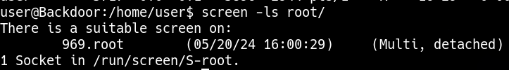

____

```bash
ps -faux | grep screen
```

In general, it’s not possible to log into other user’s screen sessions. However, there are configurations that allow that, and that happens to be what I’ll exploit here.

I would typically look at this in Beyond Root, but too many people are going to look at Backdoor and assume it’s typical to just own `screen` by hoping into another user’s session. That is not a default case, as it has to be configured a very specific way.

First, let’s look at how `screen` is being `invoked`. There’s a cron running `find /var/run/screen/S-root/ -empty -exec screen -dmS root ;\`. When a session is created, `screen` creates a folder in `/var/run/screen/S-[username]/[sesison id].[session name]`. The `-empty` flag tells `find` to only return empty directories or files. So it will only return something if that `S-root` folder is empty, which means there is no session. If that is the case (there’s no `screen` session in `S-root`), it will run `screen` to start one.

It runs `screen` with three args, and the [man page](https://linux.die.net/man/1/screen) shows:

- `-D -m` (which also covers `-dm`) - starts screen in “detached mode”, and doesn’t fork a new process. If the session ends, it exits as well.
- `-S root` - names the session, in this case, “root”

This on it’s own is not enough for another user to try to connect to the session. [This StackExchange answer](https://unix.stackexchange.com/a/163878/369627) talks about how to set up `screen` in multiuser mode. Once inside the session, the user needs to `multiuser on` and add the user that can connect to an access control list. As root, I can see this is done in `/root/.screenrc` (which runs each time `screen` starts):


```
multiuser on                                                                    
acladd user                                                                     
shell -/bin/bash
```

It also notes in that post that `screen` must be SUID for this to work. It isn’t on my Ubuntu 20.04 machine by default, but I understand that some distros do ship with it that way (I remember seeing it as a SUID binary on a certain 24-hour exam I took in 2018).

Because `screen` is configured exactly this way, I can exploit it as follows.

```bash
screen -ls root/
```



```bash
TERM=screen screen -x root/root
```
