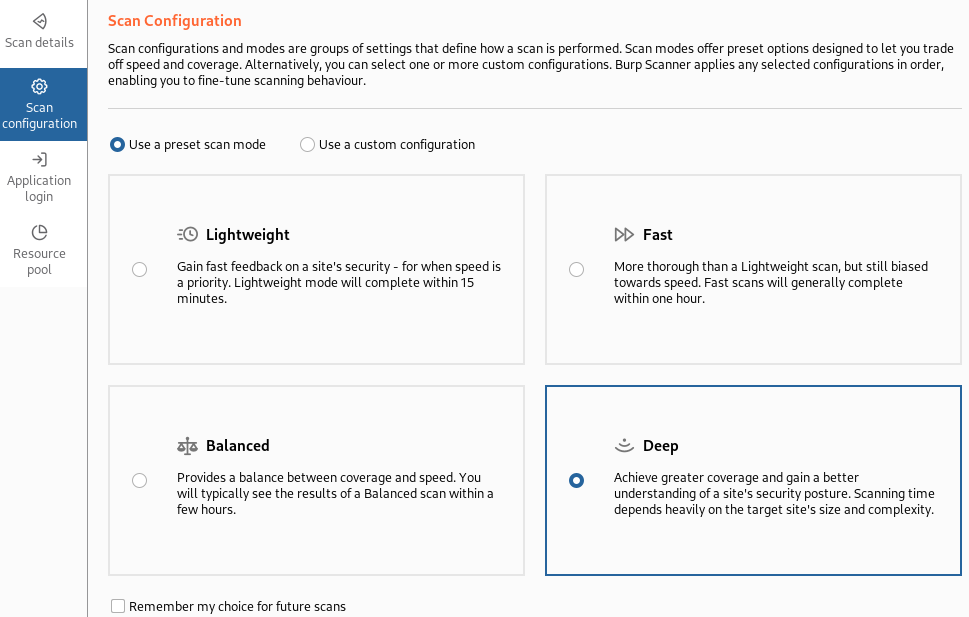
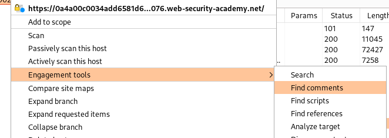
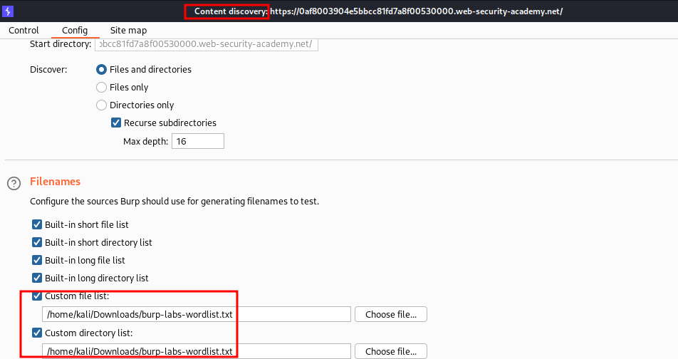

____



# Content Discovery



https://github.com/botesjuan/Burp-Suite-Certified-Practitioner-Exam-Study/blob/main/wordlists/burp-labs-wordlist.txt


# Git 

View older commits

```bash
git log
```

```bash
git show c45b2c6782913dfdf4674a86951ecf158dfda134
```
